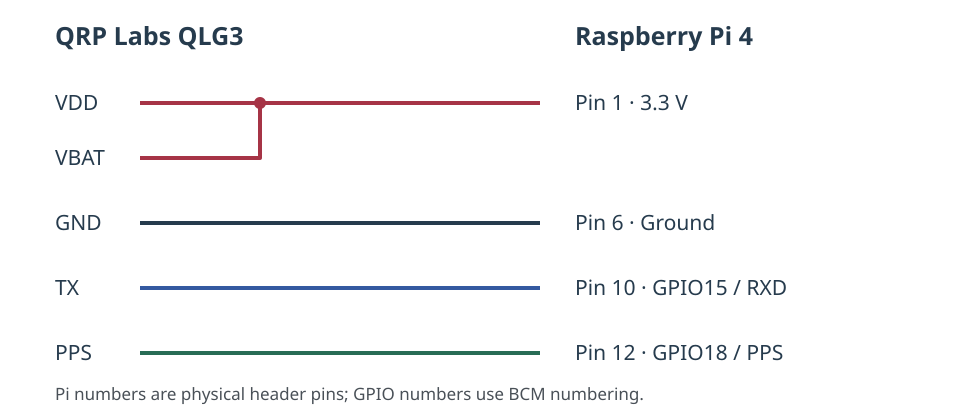

# Validation platform

This example GPS/PPS operator platform pairs a **Raspberry Pi 4 Model B**
with a **QRP Labs QLG3 GPS receiver**. The receiver supplies serial UTC data
and a precise PPS input for the operating system's time service. WsprryPi
uses Chrony's clock-frequency estimate for GPIO RF calibration.

The connections use BCM GPIO numbering and physical numbers on the Pi's
40-pin header. Match the selected software GPIO roles to the wiring, and
remove power before changing connections. Each GPIO has one exclusive role.

## Parts and connections

| Part | Platform use |
| --- | --- |
| [Raspberry Pi 4 Model B](https://www.raspberrypi.com/documentation/computers/raspberry-pi.html#gpio) | Serial receive, PPS input, and GPIO RF output |
| [QRP Labs QLG3](https://qrp-labs.com/qlg3.html) ([kit](https://shop.qrp-labs.com/qlg3)) | GPS serial data and PPS, powered from 3.3 V |
| Connecting leads | Jumper wiring, with a joined VDD/VBAT supply lead |

## GPS/PPS wiring



| <span class="no-break">QLG3</span> | Raspberry Pi connection |
| --- | --- |
| <span class="no-break">VDD</span> | Physical pin 1: 3.3 V GPS supply |
| <span class="no-break">VBAT</span> | Physical pin 1: same 3.3 V supply as VDD, powering the backup input |
| <span class="no-break">GND</span> | Physical pin 6: shared ground |
| <span class="no-break">TX</span> | Physical pin 10: GPIO15 / RXD, GPS serial output to Pi receive input |
| <span class="no-break">PPS</span> | Physical pin 12: GPIO18 PPS input |

**VDD and VBAT join to the same 3.3 V supply.** The QLG3 specifies a regulated
3.3 V supply; this platform powers VBAT alongside VDD rather than using a
separate backup battery. The QLG3 five-pin connection does not require a Pi TX
connection. See the [QLG3 documentation](https://qrp-labs.com/qlg3.html) and the
[QMX+ assembly manual, pages 62–63](https://www.qrp-labs.com/images/qmxp/manuals/assembly_2_00.pdf)
for its supply arrangement.

The serial line supplies UTC information; PPS supplies the precise second
boundary. **GPIO18 is physical pin 12**, not physical pin 18. GPIO15/RXD is
physical pin 10. Verify the board orientation and physical numbers rather than
relying on wire colors or left/right position.

## Software assignments

Configure Linux's existing GPS serial and GPIO PPS support for the connections
above. The serial input is connected to GPIO15/RXD; the system's `serial0`
alias identifies its UART. Linux's PPS GPIO assignment must match **GPIO18**.
WsprryPi does not configure the UART, PPS overlay, GPIO mux, or Chrony.

In **Setup > Transmitter > GPIO Output > Frequency calibration**, enable
**System clock estimate**. The corresponding INI setting is:

```ini
[GPIO]
Use System Clock Frequency Estimate = True
```

The GPS/PPS receiver is an optional source for Chrony. Linux/GPS services
and Chrony handle the serial and PPS inputs; WsprryPi does not directly
capture PPS on Pi 1–4 and has no PPS-input GPIO setting for this platform.
Chrony can also use network time sources without a GPS/PPS receiver.

Keep the OS-configured GPIO18 PPS input separate from RF output, LEDs,
amplifier controls, shutdown buttons, and band selectors. GPIO18 is physical
pin 12. The Linux `ppsN` device number is separate from the GPIO number.

Verify Chrony's synchronization before transmission. See
{ref}`Pi 1–4 host-frequency calibration <pi1-4-host-frequency-calibration>`
for the relationship between OS clock discipline and WsprryPi's RF model.

(configure-and-verify-chrony)=
### Configure and verify Chrony

WsprryPi uses the Raspberry Pi's synchronized UTC clock to schedule
transmissions. For Pi 1–4 GPIO output, it can also use Chrony's estimate of
the host oscillator's frequency error to correct the RF frequency model.

GPS/PPS is optional. Chrony can obtain time from network servers, or from a
suitable GPS receiver through Linux PPS support and GPS services. GPS serial
data supplies the UTC date and time; PPS supplies a precise second boundary.

For GPS/PPS configuration, follow the
[GPSD Time Service HOWTO](https://gpsd.gitlab.io/gpsd/gpsd-time-service-howto)
and [Chrony configuration examples](https://chrony-project.org/examples.html).
The [Chrony configuration manual](https://chrony-project.org/doc/latest/chrony.conf.html)
documents reference-clock options. Match device paths and GPIO assignments to
the actual receiver, Raspberry Pi model, and operating system.

After configuration, inspect the time service:

```sh
chronyc tracking
chronyc sources -v
chronyc sourcestats -v
```

Confirm that Chrony reports normal leap status, a selected source marked
`*`, and recent source observations. For GPS/PPS operation, verify that the
intended local reference is selected; a connected receiver or a source named
“PPS” alone does not establish that it is being used. Allow the frequency
estimate to settle. WsprryPi separately checks its quality before applying it.

#### Time synchronization and RF calibration

The correction depends on the transmitter backend:

- **Pi 1–4 GPIO:** Enable **System clock estimate** to use the qualified
  Chrony estimate. GPS/PPS can improve that estimate, but does not eliminate
  every source of RF error.
- **Pi 5 GPIO/RP1:** RP1's RF clock is separate from the host clock. Use the
  documented {ref}`Direct PPS calibration <direct-pps-calibration-on-pi-5>`
  configuration when measuring that clock against PPS.
- **Si5351:** RF accuracy depends on the Si5351's reference oscillator and
  applicable calibration settings. Synchronizing the Pi with Chrony does
  not directly calibrate the Si5351 reference.

Correct UTC time and accurate RF frequency are separate requirements.
Verify each for the selected transmitter configuration.
