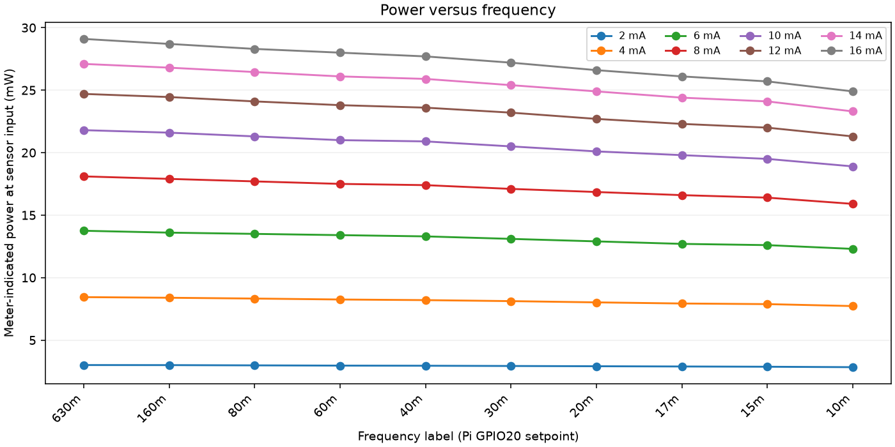
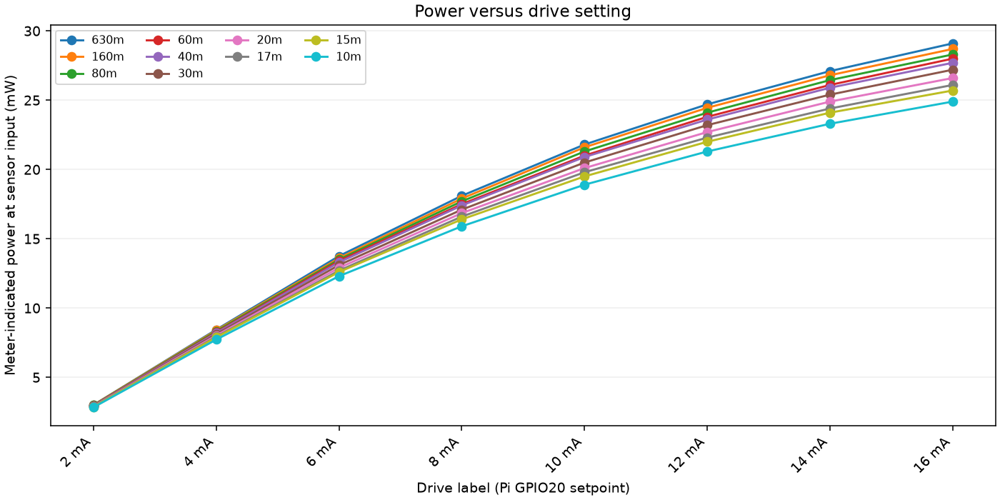
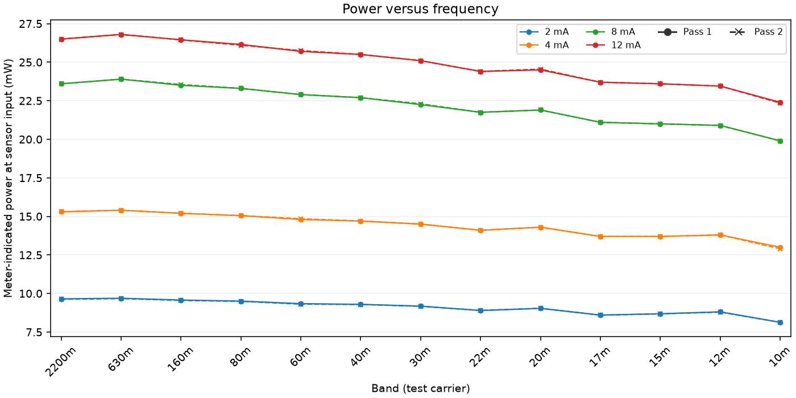
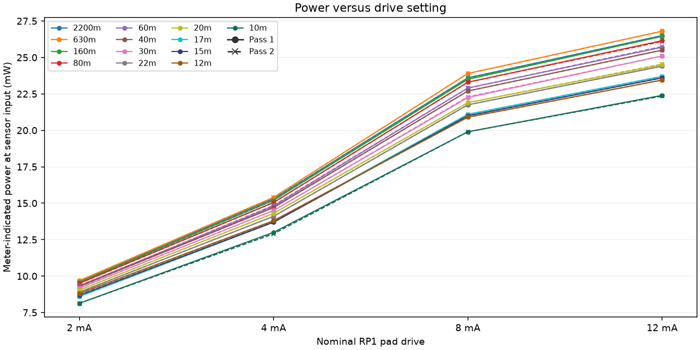

# RF and Electrical Reference

## PWM Peripheral

The GPIO RF backend uses the Raspberry Pi PWM peripheral to time the frequency transitions of the output clock.

The Raspberry Pi sound subsystem also uses this peripheral, so sound activity during a WSPR transmission can interfere with transmission quality.

The install script disables the onboard audio path automatically, so most users do not need to make manual changes.

This restriction applies only to the direct GPIO RF backend. External hardware backends such as Si5351 are not affected.

## RF and Electrical Considerations

The GPIO RF backend produces a square-wave RF clock, so a low-pass filter is required.

For the reasoning behind that requirement, see {doc}`../FAQ/lowpass-filter-justification`.

Connect a low-pass filter through a DC-blocking capacitor to the configured GPIO4 or GPIO20 `GPCLK0` RF output and a ground pin on the Raspberry Pi before connecting an antenna.

GPIO4 is on header pin 7, and GPIO20 is on header pin 38. Header pin 9 is a nearby ground connection.

See:

- http://elinux.org/RPi_Low-level_peripherals

for Raspberry Pi pin layout details.

Examples of low-pass filters can be found here:

- http://www.gqrp.com/harmonic_filters.pdf

TAPR also offers a Raspberry Pi shield with filtering and amplification:

- https://www.tapr.org/kits_20M-wsprrypi-pi.html

Set GPIO drive strength from the command line or under [Setup → Transmitter → GPIO Power Level](../User_Interface/Setup/Transmitter/index.md#gpio-power-level).

Even at low power levels, WSPR transmissions are commonly received over very long distances.

Because the Raspberry Pi does not strongly attenuate ripple and noise from the 5 V supply, use a regulated power supply with good ripple suppression.

Supply ripple can appear as mixing products centered around the transmit carrier, typically at 100 Hz or 120 Hz.

Do not expose GPIO pins to voltages or currents above the Raspberry Pi absolute maximum ratings.

The selected GPIO RF pin outputs a 3.3 V digital clock with a maximum current of approximately 16 mA.

Do not:

- Short the selected GPIO RF output directly to ground
- Connect a resistive dummy load directly to the GPIO
- Connect external amplifier keying circuitry directly to GPIO pins

Use appropriate isolation when controlling external amplifiers.

Most amplifiers expect their control line to be switched relative to chassis ground, which usually requires:

- A relay
- An SSR
- A MOSFET driver
- Or another isolated switching stage

Do not connect amplifier keying inputs directly to Raspberry Pi GPIO pins.

A DC-blocking capacitor should always be used when connecting transformers, filters, or antennas to the GPIO RF output.

Antennas can also expose GPIO pins to:

- Static discharge
- Induced RF energy
- Lightning transients

Some form of isolation and protection is strongly recommended.

## Measured bare-GPIO power

The graphs show **meter-indicated power at the sensor input**. Harmonics from the bare square-wave output can contribute to the readings. These measurements describe the tested board and load. Measure the filtered RF path for antenna-port power.

### Raspberry Pi Model A+ (BCM2835) GPIO20

The graphs show a bare **Raspberry Pi Model A+ (BCM2835) GPIO20** sweep recorded on **25 November 2026 (UTC)** by Lee Bussy [AA0NT]. A coax adapter connected GPIO20 directly to an **HP 8482A power sensor** on an **HP 437B power meter**. The sweep covered ten carriers at eight nominal drive settings from **2 to 16 mA** in **2 mA** steps. The meter applied the sensor calibration factor for each carrier, and two readings were averaged per point.

| Band | Test Tone RF carrier (Hz) |
| --- | ---: |
| 630 m | 475,700 |
| 160 m | 1,838,100 |
| 80 m | 3,570,100 |
| 60 m | 5,366,200 |
| 40 m | 7,040,100 |
| 30 m | 10,140,200 |
| 20 m | 14,097,100 |
| 17 m | 18,106,100 |
| 15 m | 21,096,100 |
| 10 m | 28,126,100 |

*Power versus frequency setting.* The equally spaced band labels correspond to the Test Tone carriers in the table. At 16 mA, the mean indication was **29.1 mW** on 630 m, **26.6 mW** on 20 m, and **24.9 mW** on 10 m.

*Power versus GPIO drive setting.* The indicated power rose at every tested carrier as nominal drive increased. Each additional 2 mA step produced a smaller power increase than the previous step.

### Raspberry Pi 5 (RP1) GPIO4

The graphs show a bare **Raspberry Pi 5 (RP1) GPIO4** sweep recorded on **25 November 2026 (UTC)** by Lee Bussy [AA0NT]. A coax adapter connected GPIO4 directly to an **HP 8482A power sensor** on an **HP 437B power meter**. The test used the **RP1-GPCLK-DKMS v1.1.0 candidate** (commit `7ba4d6e`) with WsprryPi 4.0.0-rc.1. Two passes covered 13 carriers at four nominal drive settings of **2, 4, 8, and 12 mA** for a total of 104 points. The meter applied the sensor calibration factor for each carrier, and two readings were averaged per point.

| Band | Test RF carrier (Hz) |
| --- | ---: |
| 2200 m | 137,500 |
| 630 m | 475,700 |
| 160 m | 1,838,100 |
| 80 m | 3,570,100 |
| 60 m | 5,366,200 |
| 40 m | 7,040,100 |
| 30 m | 10,140,200 |
| 22 m | 13,560,000 |
| 20 m | 14,097,100 |
| 17 m | 18,106,100 |
| 15 m | 21,096,100 |
| 12 m | 24,926,100 |
| 10 m | 28,126,100 |

The 22 m points used the candidate driver's finite-tone interface at 13.560 MHz. All other points used WsprryPi's bounded Test Tone.

*Power versus frequency setting.* The equally spaced band labels correspond to the carriers in the table. At 12 mA, the mean across both passes was **26.8 mW** on 630 m, **24.5 mW** on 20 m, and **22.4 mW** on 10 m.

*Power versus GPIO drive setting.* The indicated power rose with each increase in nominal drive at all 13 carriers in both passes. The largest absolute difference between matching point means was **0.10 mW**.
