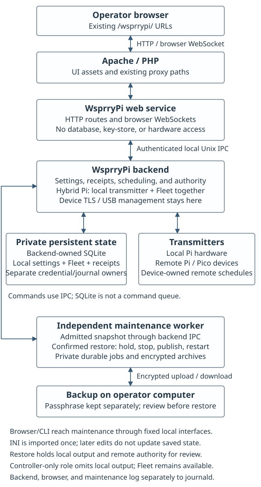

# WsprryPi System Internals

The SQLite source implementation separates browser handling from transmitter and settings ownership. A normal Pi can transmit locally and manage Fleet devices at the same time. The explicit controller-only role omits local output; it is not required for Fleet operation on a transmitter Pi.

## Services and state

| Owner | Installed Linux service | Responsibility |
| --- | --- | --- |
| Backend | `wsprrypi.service` | Private application state, scheduling, local output, and device management |
| Browser service | `wsprrypi-web.service` | HTTP routes, including `/config`, and browser WebSockets through authenticated local IPC |
| Maintenance worker | `wsprrypi-maintenance.service` | Durable encrypted backup/restore jobs and fixed backend lifecycle operations |
| Apache/PHP | Existing web installation | UI assets at `/var/www/html/wsprrypi` and the existing `/wsprrypi/` proxy paths |

The WsprryPi executable is installed at `/usr/local/bin/wsprrypi` and has explicit process roles. The browser service is part of WsprryPi, not an Apache module. Apache still serves the UI and forwards HTTP and browser WebSocket traffic to it. Device-to-device network/TLS and USB management remain with the backend.

The backend owns `/var/lib/wsprrypi/application-state`, with the selected `generation-N/state.sqlite3`. SQLite is authoritative for supported local settings, Fleet definitions, and coordinated receipts. Private credentials, pairing history, and some per-target journals retain their own owners and must be captured coherently. Browser and settings CLI requests never open the database. SQLite is not a command queue, and a committed record cannot establish that a physical or remote action completed.

Backend IPC lives under `/run/wsprrypi`. The unprivileged browser service has its own listener cache under `/var/lib/wsprrypi-web`; it cannot read backend state or transmitter devices. The independent privileged maintenance worker owns `/var/lib/wsprrypi-maintenance` and `/run/wsprrypi-maintenance`, survives backend replacement, and exposes only fixed admitted recovery operations.

Restarting the browser service leaves the backend and its native schedule running. When the backend is unavailable, ordinary browser requests report unavailability instead of returning default settings or replaying commands. Remote devices retain their autonomous schedules. Maintenance jobs and already admitted recovery downloads can remain available across backend restart.

INI is a [one-time migration source](../Advanced_Operations/ini_configuration.md). After migration, there is no INI watcher, autosave, or restart fallback. Use [validated local settings commands](../Command_Line_Operations/saved_settings.md) for advanced saved values and [Maintenance backup and restore](../User_Interface/Maintenance/backup_restore.md) for complete recovery archives.

## Data flow

:::{only} not latex

:::

:::{only} latex

:::

{download}`Open the full-size SVG <wsprrypi_data_flow.svg>` or {download}`download the matching PDF <wsprrypi_data_flow.pdf>` to inspect the diagram at a larger size. The SVG is the editable vector source; regenerate the PDF from that source when changing the flow.

## Logs and diagnostics

The three WsprryPi services log separately to `systemd-journald`. See [View Logs](../User_Interface/Logs/index.md) for the operator log panel. The support collector records separate service and IPC observations and obtains supported settings through the backend's administrator diagnostic export, rather than copying live databases or credential stores.

These are current source contracts. Local software tests do not qualify installed service lifecycle, Pi timing, physical USB, GPIO, or RF. The dedicated controller-only distribution and additional native platform integration associated with issue #475 remain separate work.
