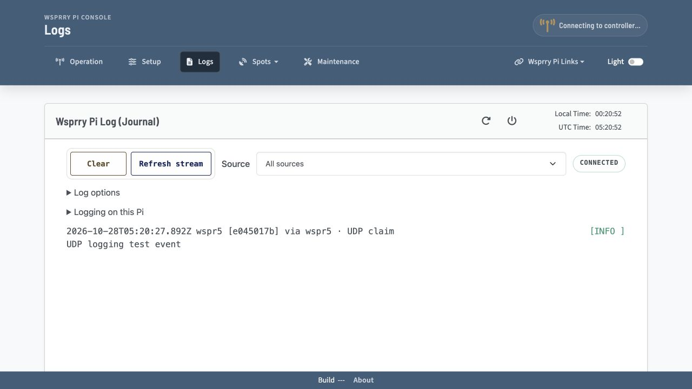

# Logs



The log page auto-refreshes as your WsprryPi server generates logs. It accesses them from the Debian systemd-journald system.

Choose **Source** beside **Clear** and **Refresh stream** to show **All sources**, **Local Pi** or one Pico. Attached Picos appear before collection is enabled. Each Pico is identified by its saved name or USB serial and stable device ID. Selecting a source only filters the journal; save a USB device in Fleet before enabling its collection. The example above uses sample records to show these labels.

Pico records keep their own hostname, boot and event sequence. When the Pico has UTC, the displayed timestamp is its event time. Otherwise, **received** marks the Pi's receipt time. A host receipt time does not establish the Pico's clock accuracy.

Open **Log options** to filter severity, **Pause view** or **Export visible logs**. Pause stops this browser's live view; **Resume view** continues from its journal cursor. Export saves the normalized records retained by this view as a JSON-lines file, including origin metadata. Clear removes the displayed records without deleting the system journal. Source and severity selections have separate resume cursors.

## Collect a Pico's USB logs

1. Save the USB Pico in **Setup → Fleet**. Select its USB management connection, open **USB logging on this Pico**, and choose **Read logging settings**. Enable export, choose its maximum severity and **Save Pico logging**. Saved and active states are shown separately. Older firmware requires an update before these controls are available.
2. Open **Logs**, choose that Pico in **Source**, open **Log options** and enable **Collect this Pico's USB logs**. Firmware export belongs to the Pico; collection belongs to this Pi. Both must be enabled to receive records.
3. Use **Refresh sources** to read the saved collection policy and current status after an uncertain save. Read and review the saved state before sending another change.

Collection continues when a browser closes or its view is paused. The Pi supports up to eight collected USB Picos. Default collection and Pico export are disabled. The collector uses the Console interface; USB WTP jobs and management retain their separate interfaces. Logging never enables schedules or grants transmitter ownership.

Turn collection off before opening that Pico's Console in another terminal or browser tool. Close the other tool before turning collection on again. Firmware maintenance releases Console and reacquires it after the matching device reconnects. A changed device identity is not enrolled automatically. A saved policy remains selectable so it can be disabled after removing its Fleet profile.

## Missing or interrupted logs

- **Firmware logging disabled:** read the Pico's settings and enable export. Enable collection on this Pi separately.
- **Console busy or disconnected:** release Console in the other tool, check the data cable and refresh the source list. The collector retries the same saved device; tty ordering does not select another Pico.
- **Maintenance:** finish or recover the firmware update before expecting new records. Losing USB does not prove that an accepted radio job stopped.
- **Unsupported or unresponsive firmware:** update the selected Pico, verify its identity and read its logging settings again.
- **Dropped or rejected records:** reduce the exported severity range and inspect the source status. Pico logging has bounded queues and rate limits; it is a diagnostic feed, not a lossless event archive.
- **No matching records:** choose All sources or a broader severity filter, then verify export and collection status. An empty view does not mean that the transmitter is inactive.

UDP logging and forwarding between Pis are unavailable. The source selector shows local and collected USB records; it does not create a network collector.

## Journal history and retention

The log page reads the Pi's systemd journal. Retention follows the host's journald configuration.

If you need more than what is displayed, you can find the complete logs on the Pi with the command `journalctl -u wsprrypi.service`. By default, the Raspberry Pi retains only the current boot’s logs. You can make these persistent with:

```bash
sudo mkdir -p /etc/systemd/journald.conf.d
sudo nano /etc/systemd/journald.conf.d/persistent.conf
```

Then put this in the persistent.conf file

```ini
[Journal]
Storage=persistent
SystemMaxUse=64M
SystemKeepFree=200M
MaxRetentionSec=14day
```

Then restart journald:

```bash
sudo systemctl restart systemd-journald
```

And then reboot:

```bash
sudo reboot
```

After reboot you can see the log versions stored:

```bash
journalctl --list-boots
```

Then, to go back to view the previous boot’s logs, issue the command:

```bash
journalctl -u wsprrypi.service -b -1
```

If you want to pull from multiple boots (change the range as appropriate):)

```bash
journalctl -u wsprrypi.service -b -3 -b -2 -b -1 -b 0
```
