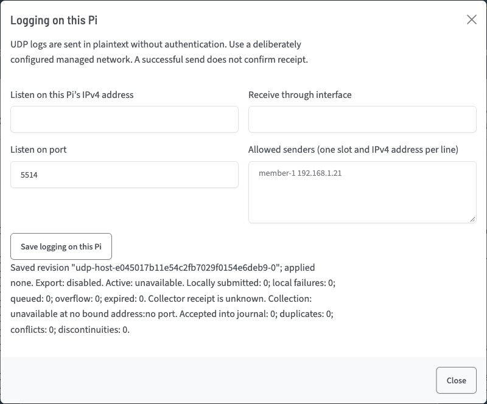

(log-card)=
# Logs


The log page auto-refreshes as your WsprryPi server generates logs. It accesses them from the Debian systemd-journald system.

Choose **Source** beside **Clear** and **Refresh stream** to show **All sources**, **Local Pi**, an attached Pico or a network origin observed through a configured peer. Attached Picos appear before collection is enabled. Each Pico is identified by its saved name or USB serial and stable device ID. Selecting a source only filters the journal; save a USB device in Fleet before enabling its collection. The example above shows a received native Pi UDP test event.

The source selector and Pico log prefixes use the saved Fleet name when available, with the reported hostname as a fallback. Displayed names omit a terminal `.local`; log prefixes retain the bracketed short device ID. Refresh sources to read a renamed Fleet profile. Journal records and exports keep the full reported hostname, boot and event sequence. When the Pico has UTC, the displayed timestamp is its event time. Otherwise, **received** marks the Pi's receipt time. A host receipt time does not establish the Pico's clock accuracy.

Open **Log options** to filter severity, **Pause view** or **Export visible logs**. Pause stops this browser's live view; **Resume view** continues from its journal cursor. Export saves the normalized records retained by this view as a JSON-lines file, including origin metadata. Clear removes the displayed records without deleting the system journal. Source and severity selections have separate resume cursors.

## Collect a Pico's USB logs

In the Pico's own browser, USB and UDP export settings are under **Wi-Fi/Host → Logging**. Saved values are visible while locked; use the hostname lock to authorize a change. The following Fleet controls configure the selected member from WsprryPi.

1. Save the USB Pico in **Setup → Fleet**. Select its USB management connection, open **USB logging on this Pico**, and choose **Read logging settings**. Enable export, choose its maximum severity and **Save Pico logging**. Saved and active states are shown separately. Older firmware requires an update before these controls are available.
2. Open **Logs**, choose that Pico in **Source**, open **Log options** and enable **Collect this Pico's USB logs**. Firmware export belongs to the Pico; collection belongs to this Pi. Both must be enabled to receive records.
3. Use **Refresh sources** to read the saved collection policy and current status after an uncertain save. Read and review the saved state before sending another change.

Collection continues when a browser closes or its view is paused. The Pi supports up to eight collected USB Picos. Default collection and Pico export are disabled. Collection uses the Pico’s dedicated Logging interface; Console, WTP jobs and management retain their separate interfaces. Logging never enables schedules or grants transmitter ownership.

Console remains available while logs are collected. Firmware maintenance releases the Logging interface and reacquires it after the matching device reconnects. A changed device identity is not enrolled automatically. A saved policy remains selectable so it can be disabled after removing its Fleet profile.

## Missing or interrupted logs

- **Firmware logging disabled:** read the Pico's settings and enable export. Enable collection on this Pi separately.
- **Logging interface busy or disconnected:** close any other tool using the dedicated Logging port, check the data cable and refresh the source list. The collector retries the same saved device; tty ordering does not select another Pico.
- **Maintenance:** finish or recover the firmware update before expecting new records. Losing USB does not prove that an accepted radio job stopped.
- **Update Pico firmware for a dedicated Logging port:** install compatible firmware that provides the dedicated Logging interface, verify its identity and read its logging settings again. Earlier firmware is not collected through Console.
- **Dropped or rejected records:** reduce the exported severity range and inspect the source status. Pico logging has bounded queues and rate limits; it is a diagnostic feed, not a lossless event archive.
- **No matching records:** choose All sources or a broader severity filter, then verify export and collection status. An empty view does not mean that the transmitter is inactive.

## Receive UDP logs on this Pi

Any Pi can collect logs independently of its Fleet controller/member role. Export and listening are disabled initially. UDP uses plaintext without authentication. Use a deliberately configured managed network; a successful send does not confirm receipt. An IPv4 peer list restricts admission but does not authenticate the sender.



1. Open **Logging on this Pi** and choose **Read UDP logging settings**. Verify the displayed local collector ID before editing.
2. Under **Receive network logs on this Pi**, enable network log collection. Enter this Pi's current IPv4 address, its interface name, and port **5514**. The listener binds that address and interface; it does not listen on every interface.
3. Enter allowed senders as one unique slot and IPv4 address per line, such as `member-1 192.168.1.21`. Up to 32 peers are supported. An empty list admits nothing.
4. Choose **Save logging on this Pi**, then read settings again. **Ready** means the listener is locally bound. Check the journal submission counter and actual records separately; journald can still discard a submitted record under its own limits.

Port **514** is also supported through an explicitly managed systemd socket. A conflicting port is refused before the old listener is stopped. Installation does not open a firewall or replace another logging daemon. Unsupported software, inactive service, invalid policy and bind failure remain visible near the controls.

The `wsprrypi-log` service runs as the dedicated unprivileged `wsprrylog` user, without transmitter or device access. Its journal-read group grants broad access to this host's journal while the service runs; the reader narrows its query to the transmitter service. The browser user is not given that group. Memory and PID cgroup controllers must be available so the service can enforce its 32 MiB and two-task ceilings. An unavailable controller prevents activation. The installer does not change kernel boot settings. On affected Raspberry Pi systems, an administrator can review the [Raspberry Pi kernel memory-controller discussion](https://github.com/raspberrypi/linux/issues/6980) and verify the available controllers after a deliberate reboot.

## Send or forward logs from this Pi

1. Read **Logging on this Pi** and enable **UDP log export**. Enter one collector IPv4 address, port and explicit outgoing interface. Hostnames, IPv6, broadcast, multicast and this Pi's own addresses are refused.
2. Select **Include native Pi events** for approved application diagnostics. Select up to eight attached-Pico sources to forward their already collected USB records. Save each source in Fleet and enable its USB export and collection first; forwarding selection does not enable either of them.
3. Choose severity, event filters and rate limits, then **Save logging on this Pi** and read back. Valid drafts remain available after an error. After a conflict or uncertain reply, read again, compare **Saved UDP logging settings** with the preserved draft and choose **Confirm review** before another save.
4. For native export, **Test saved UDP export** admits one fixed diagnostic event. Its successful response means local admission. Confirm receipt independently in the destination journal and Logs view. USB forwarding can be checked with a finite sequence of Pico startup or connection events.

Each sender uses one destination. The Pi exports approved native application events and selected USB sources. UDP imports remain local to their collector and cannot be forwarded onward, so configuring collectors in a cycle does not create a log-forwarding loop. The service starts at the current journal tail and has no durable replay spool. Enabling export excludes events created while it was disabled. Restart or journal rotation creates a visible discontinuity rather than catching up old traffic.

## Identify network arrivals

The **Source** picker includes remote Pis and Picos observed through configured peers. Each choice includes its stable origin ID, peer slot and direct/relay path. **Local Pi** means this Pi's own application origin. A remote Pi never becomes Local Pi merely because this Pi stored its record. Direct Pico UDP and a copy forwarded over USB remain distinct arrival paths. Rows identify UDP claims and relayed arrivals; **received** marks receipt time when origin UTC is unavailable. Receipt time does not prove origin clock accuracy.

Relate arrival copies using the origin device ID, boot ID and sequence, then compare the peer and relay details. A Pico reboot retains its device ID but starts a new boot identity and sequence. After USB reconnection, the member rechecks the saved physical device before collecting it again. Source history can remain selectable while that device is disconnected; it is not live connection status. Direct UDP can continue across a USB disconnect only when the Pico remains powered and connected to station Wi-Fi.

Exact repeats within one peer/path scope are suppressed for a bounded interval; conflicting content is rejected and counted. Expiry or restart can admit a duplicate again. An address or claimed ID can be spoofed, and a false record can affect its unauthenticated peer scope. Physically checked USB records have independent admission. Repeated claimed IDs raise a warning and retain separate selectable sources. The menu is bounded to configured peers and 64 recently observed origins per peer; additional history remains available in **All sources** with an overflow notice.

Source, peer address, ingress, severity, stream version and verified collector identity scope the view's resume cursor. Removing or rebinding a peer resets its affected view with a gap notice. Pause, Clear and Export affect this browser view. A connected log stream does not establish collector or sender health.

## Stop or remove network logging

Disable export and network collection independently, save, and read back before removing software. Confirm the logging service/socket is inactive and no unintended listening endpoint remains. The normal WsprryPi remover stops the managed worker and socket and preserves its separate `<ini>.udp-logs.json` policy for deliberate deletion. It does not replace the host logging stack or change journald retention. Keep the recovery firmware bundle before a Pico rollback; a firmware image using the older, larger application region is refused after the new storage layout rather than erasing settings automatically.

## Journal history and retention

The log page reads the Pi's systemd journal. Retention follows the host's journald configuration. Network imports use the real `wsprrypi-log.service` journal unit. They share the host journal's storage and retention budget, so enabling a collector increases competition with other history. Queues are volatile; journald is the durable history. Collector kernel drops, application drops and journald rate-limit drops are separate.

Use `journalctl -u wsprrypi.service -u wsprrypi-log.service` on the Pi to inspect available records from both units. Available boots depend on the host's storage and retention settings; inspect them with:

```bash
journalctl --list-boots
```

For the previous available boot, or a time range across available boots:

```bash
journalctl -u wsprrypi.service -u wsprrypi-log.service -b -1
journalctl -u wsprrypi.service -u wsprrypi-log.service --since "3 days ago"
```

See the [journalctl manual](https://www.freedesktop.org/software/systemd/man/latest/journalctl.html) for time and boot filters. Discarded history cannot be recovered by changing retention later.

If persistent history is needed, review the existing configuration, free disk space and [journald storage settings](https://www.freedesktop.org/software/systemd/man/latest/journald.conf.html) before making a deliberate host-wide change. The following example affects the entire host journal, including unrelated services; its sizes are examples rather than WsprryPi requirements. The installer does not apply it.

```bash
sudo mkdir -p /etc/systemd/journald.conf.d
sudo nano /etc/systemd/journald.conf.d/persistent.conf
```

For example, put the following in `persistent.conf` after choosing suitable limits:

```ini
[Journal]
Storage=persistent
SystemMaxUse=64M
SystemKeepFree=200M
MaxRetentionSec=14day
```

Apply the edited configuration and flush available volatile records to persistent storage:

```bash
sudo systemctl restart systemd-journald
sudo journalctl --flush
```
