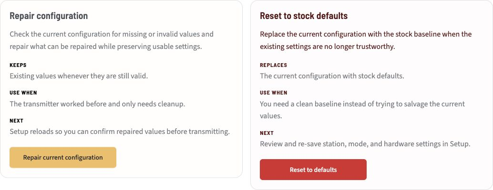

# Maintenance Card

Use the Maintenance page to repair or reset configuration, check the RF path with Test Tone, check for updates, and create a support bundle.

## Set up this transmitter

On a new installation, open **Maintenance** and use **Set up this transmitter**. Review the **Station** and **Operation** sections, including your call sign, locator, and output selection. Other settings are available in the expandable sections. Select **Save initial settings** when the configuration is ready.

Reviewing or editing the form does not save it. If validation fails, the form retains your entries. If the connection is interrupted during a save, use **Check saved result** before attempting another change.

Setup saves transmission and scheduling disabled. It does not start a tone, transmit a message, or enable a schedule. After the saved configuration and startup are verified, the ordinary Maintenance controls become available.

Updates and configuration resets retain the installation's scheduling history. If established history is missing or damaged, the page opens read-only recovery; it cannot use initial setup or Reset to bypass that condition. An existing installation with a previous local schedule uses [local scheduling migration](#migrate-a-local-pi-schedule) rather than initial setup. Outstanding remote WTP duties require [retirement before upgrading](#retire-remote-wtp-work-before-upgrading).

## Controller access

Use **Controller access** to connect one Pi to another for settings management. Keep **Privileged network safety** enforced on both devices. A transmitter Pi and a controller-only Pi can each manage another Pi.

1. On the Pi you want to manage, open **Maintenance** and select **Pair this Pi**. Keep that page open to view its temporary code.
2. On the controller’s **Maintenance** page, find **Manage another Pi**. Select **Refresh devices**, choose the Pi displaying the code, enter its eight characters, and select **Connect to Pi**.
3. Wait for confirmation. Open **Setup** and choose the paired Pi under **Device**. Supported Picos attached to it by USB also become available through that connection automatically.

The code expires after two minutes and appears only in the page that opened the pairing window. If it expires or that page closes, return to that Pi’s Maintenance page and open pairing again to generate a new code. Security is configured automatically on the devices. Pairing does not change output selection, Transmit permission, schedules, or running work.

To change who manages a Pi, open that Pi’s own Maintenance page and select **Replace controller**. Pair from the new controller using the new temporary code. The old controller can be offline; its ordinary management access is revoked when replacement completes. **Remove controller…** offers an explicit confirmation to remove management access. Running work and saved schedules continue. **Pair again** is offered when access recovery is required.

If a controller-access change is unconfirmed, use **Check saved result**. Refreshing status or checking the result does not repeat the change. Keep an unknown result pending and follow its recovery feedback before another action.

## Scheduling ownership

The first startup with the native scheduling policy performs the local handover automatically when ownership and output are verified. It saves native scheduling disabled for review. Retiring remote WTP work is a separate procedure that must finish before replacing WTP-capable software.

### Migrate a local Pi schedule

This policy applies when the selected Pi produces its own signal through GPIO or Si5351. The previous local scheduler cannot admit new recurring work while migration is pending. Once native output quiescence and local ownership are verified, the Pi retires the previous scheduling authority and saves the existing configuration with native scheduling disabled. It does not require WTP support or an open browser.

1. After installation, open **Maintenance → Scheduling ownership** and choose the Pi under **Device**.
2. Check for **Migration completed; schedule disabled pending review.** This confirms that local handover finished and the native policy is saved disabled.
3. If migration is held, resolve the reported output or ownership recovery condition. Preserve scheduling history. Once resolved, restart through the normal maintenance procedure to retry automatic migration, or use **Review migration**, verify the identified device, acknowledge the change, and select **Confirm migration** when offered. Reviewing alone changes nothing.
4. Open [Setup → Scheduling](../Setup/Scheduling/index.md) for the same Pi. Read the disabled policy and review its mode, frequency settings, and any solar policy. Save and verify any changes with **Save disabled policy**.
5. Select **Enable saved schedule** when ready. Transmit permission and boot behavior remain separate; enabling scheduling does not turn on Transmit.

The authority states distinguish progress: **legacy** means the required handover remains held, **staged** confirms migration with native scheduling disabled, and **native** follows explicit enable of the saved native schedule. Ordinary scheduling can leave solar selection off.

Installing this policy makes the local handover mandatory. Unknown output, incomplete scheduling authority, or unresolved work keeps recurrence held rather than reopening the previous scheduler. Reinstalling or restarting preserves the enable state of a verified native schedule. The previous local schedule remains available only through the separate, explicit restoration workflow below.

Use **Check saved result** when a reply is interrupted. Pending or unknown work keeps migration pending; closing the browser or restarting the Pi does not prove completion. Checking a result does not resend the request. After a restart during handover, review current output and explicitly confirm reconciliation when offered.

When a previous local schedule is available, choose it under **Previous schedule** and select **Review previous schedule**. Restoring it first requests Stop and disables device-owned recurrence, then verifies output is reconciled before granting restoration. The previous local schedule may then transmit under its saved settings. This control cannot restore controller-owned WTP schedules.

If preparation or restoration is unconfirmed, stop and use **Check saved result**. A confirmed preparation step does not automatically submit the next step; review restoration again. If management access changed and the old receipt is private, **Read current state for review** and **I reviewed this state** can resolve the controller’s block after an explicit review when offered. This does not repeat the earlier request or make its historical outcome known. Retained scheduling or output holds still apply.

### Retire remote WTP work before upgrading

This procedure applies to an older deployment where a controller sends WTP jobs to another transmitter. Current software has no WTP dispatch or listener and cannot finish those jobs. A controller's remote output cannot be converted into a native local schedule on that controller.

1. Before replacing the affected binaries or firmware, keep the compatible WTP-capable controller and transmitter software available. Back up settings and preserve ownership, assignment, and recovery records.
2. Stop new controller dispatch using that software's controls. Let accepted work finish or use its explicit stop procedure, then verify inactive, unowned output and reconcile any uncertain cleanup. Losing contact is not completion.
3. Complete the authenticated retirement for every recorded controller assignment and verify the saved result. Offline controllers or transmitters and unresolved work keep retirement pending; postpone replacement.
4. Once those duties are resolved, update the affected devices as a compatible pair. Select the device that produces the signal under **Setup → Device**, configure its native schedule, save it disabled, and review it before enable.

If already upgraded with unresolved WTP records, preserve them and obtain recovery guidance for the matching earlier controller and target software. Current read-only records do not establish cleanup. Do not delete history, reset configuration, or enable an old controller against a retirement image. **Review migration** remains unavailable for a Pi configured with remote WTP output. Local Pi migration above does not require returning to older software.

## Repair Configuration



In rare cases, you may find that your configuration is present and readable but has missing sections or is otherwise not fully functional. This can happen if you hand-edit your INI file and mistakenly delete sections or keys.

When you press the "Repair current configuration" button, repair runs without a confirmation prompt. WsprryPi creates a stock configuration file and applies your valid configuration values on top. Missing or invalid data is restored from the stock configuration.

After this action, you should review all your settings to ensure they are still correct.

## Reset to Stock

This process is helpful if your INI file is damaged on disk or completely missing.

Unlike the Repair Configuration button, it does not preserve existing user values. It copies a new stock `wsprrypi.ini` file in place of your current one if it exists, and reloads the configuration shipped with the application.

When you press the "Reset to defaults" button, a confirmation modal warns that the action replaces your existing configuration.

Confirm the action, and the process completes and returns its status.

You need to reconfigure all of your preferences before continuing to transmit.

## Privileged Network Safety

**Privileged network safety** limits configuration changes, device controls, support-bundle operations, and the browser WebSocket connection to clients on the Raspberry Pi's directly connected Ethernet or Wi-Fi networks. It is network-location access control, not authentication: it does not distinguish between users already on an allowed LAN and does not encrypt traffic.

The Maintenance page reports three values separately:

- **Requested** is the unsaved choice currently selected in the browser.
- **Configured** is the value stored in `wsprrypi.ini`.
- **Active** is the policy confirmed in the backend and Apache.

Keep **Enforced** selected for normal operation. Browser operation uses the normal port-80 Apache site; the UI does not fall back to the direct backend ports for this control. When enforcement is active, Apache also restricts the entire browser-facing WebSocket endpoint. Off-LAN clients therefore cannot use read-only WebSocket commands or receive its broadcasts.

The insecure override is intended only for deliberate administrator recovery or an explicitly accepted network design. Select **Insecure disabled**, type `DISABLE LOCAL-LAN SAFETY` exactly, and then select **Apply requested state**. The setting is not part of Setup autosave. When the insecure override is active, the page displays **NETWORK SAFETY OFF**.

Applying either value validates the candidate WsprryPi and Apache configuration, reloads Apache without rebooting, and confirms the active policy. If validation, reload, or confirmation fails, the page preserves your requested choice and reports that the requested, configured, and active values may differ. Resolve the reported problem and verify the displayed state before trying again.

Disabling this LAN check does not disable Host, Origin, CORS, malformed-request, HTTP method, command, forwarded-header, or ordinary configuration validation. See [Privileged Network Safety](network_safety.md) for protected operations, direct-backend behavior, network-change handling, and recovery guidance.

## Test Tone

A test tone is useful for checking the transmit path, calibration, and tuning. Connect the transmitter to a suitable dummy load or attenuated test path before starting. Keep the test brief, and select **End** as soon as the check is complete.

An accepted Test Tone request can still be waiting for runtime confirmation. Read the execution status before treating the tone as active. Status feedback is not a measurement of RF output.

Select **Test tone** to open the manual tone controls. This does not change the frequency saved in Setup.

### Choose the frequency source

Choose one of these frequency sources:

- **WSPR band** uses the effective USB dial preset, profile, and saved per-band preference supplied by the connected controller. The preview adds the fixed 1,500 Hz placement to obtain the RF center / steady carrier target. The standard `20m` choice targets `14,097,100 Hz`, matching CLI `--test-tone 20m`.

- **Custom RF frequency** accepts a whole-number carrier target in Hz. Entering `14095600` targets exactly `14,095,600 Hz`, matching numeric CLI `--test-tone 14095600`. No WSPR placement is added.

Neither source applies random placement. A preview is an unsaved selection; the result confirms the accepted synthesis target and runtime state separately. It does not measure output frequency. When the accepted target matches the preview, the result need not repeat the calculation.

When the controller is disconnected, **Start** and **End** are unavailable.

Test Tone targets the RF carrier shown in the preview. On the legacy GPIO backend, a frequency that crosses a hardware clock-divider boundary is rejected rather than replaced with a nearby carrier. Choose another valid frequency if this happens. The reported frequency is the controller's synthesis target; actual RF accuracy still depends on clock calibration and the measurement path. See [Transmission Timing and Calibration](../../Advanced_Operations/timing_calibration.md#interpreting-test-tone-measurements) when using a tone to measure frequency error.

The WSPR band list is controller-authorized rather than a fixed list in the browser. **Start** remains unavailable until the controller is connected, its catalog is available, a valid frequency source is selected, and normal transmission interlocks permit a test tone. A disabled button is visually muted and cannot be selected.

See [Canonical Bands and WSPR Frequency Presets](../../Advanced_Operations/canonical_bands.md) for the effective preset rules and the distinction between a WSPR dial preset and the exact RF carrier used by **Custom RF frequency**.

If scheduled WSPR or CW-family transmission is enabled, the page prompts you to stop and disable it before starting a test tone.

You must re-enable normal transmissions on the Operations page after testing.

### Read the result

Before **Start**, the frequency summary is a preview of the request. After the controller replies, the execution status reports what the controller actually committed. When the committed frequency matches the preview, the status does not repeat the full dial-frequency, offset, and RF-frequency calculation.

The execution status calls out information that changes what you should do, including:

- a committed frequency that differs from the request;
- controller selector details or warnings;
- a rejected or failed start; and
- whether **End** remains available for recovery.

**Accepted** means asynchronous startup was requested. **Active** means the controller observed runtime activity; it is not an RF measurement. Startup or execution can fail after acceptance. Read the failure and cleanup status before another Start; failed startup does not automatically resume prior work.

**End** feedback names cleanup and restoration separately. A successful Test A retired or held recurring schedule remains disabled when Test Tone ends. The manual tone does not clear retirement or resume old occurrences. The existing requirement to disable transmission before starting a tone still applies.

Tone end can restore scheduler configuration, return to managed idle, or restore an earlier CLI direct tone. Ending this transaction therefore does not always mean all output is off. If restoration fails, the status retains that failure even when Test Tone cleanup succeeded. An ordinary **Stop** disables work and prevents later tone restoration from restarting it.

Saved Setup edits and **Repair current configuration** / **Reset to defaults** can be stored while the tone owns runtime, but application is deferred until cleanup. They do not replace the running backend, mode, frequency, or selectors. Review the resulting configuration and restoration feedback before re-enabling normal transmission.

### Recover from an uncertain result

If Start or End times out, or connection drops before a confirmed result, the outcome is uncertain. Reconnect and read current status; a lost connection does not establish output-off. While connected, **End** remains available whenever an active or uncertain state requires recovery, even without the WSPR catalog. During a pending End, it stays disabled to prevent duplicate requests.

Request End once and inspect its result before another Start. Cleanup uncertainty inhibits further output. A recovery End can confirm cleanup without restoring prior work; a repeated inactive End need not report a new stop. If uncertainty persists, keep transmission disabled and use the reported local/backend recovery procedure. Conservative feedback from an older controller may lack correlation or restoration evidence; do not infer a fresh success from an unattributed reply.

## Update Checker

The WsprryPi UI automatically checks the running build against eligible releases and its trusted upstream branch on GitHub. A newer tagged release is shown as an **Update available**. A non-main development build may instead show **Newer branch build available** when its upstream branch contains the running commit and has newer commits.

Tagged-release notifications provide a link to the [Releases page](https://github.com/WsprryPi/WsprryPi/releases/). Branch-build notifications identify the target branch and commit and direct prerelease users to their designated update channel; they do not present an unrelated Releases link.

You may also check manually on the Maintenance page and force an immediate check.

You may dismiss the modal, and the footer continues to quietly show the release or branch-build notification.

You may also choose to "Never check again" either in the modal or by selecting "About" in the footer.

If you choose to never check again and wish to re-enable the checking, the opposite setting is available in the "About" footer, as well as in the update check section in the maintenance panel.

Technical information on the update check process is available in the [WsprryPi Automatic Update Polling](update_check.md) technical page.

## Support Bundle

Use **Support Bundle** when the WsprryPi maintainer asks for diagnostic information. The workflow records useful support context, creates a readable `.tar.gz` candidate locally, lets you inspect it, encrypts the exact bytes you approve, and hands only the encrypted `.age` file to a private Dropbox File Request.

Review the readable archive before encryption. See [Create and Share a Support Bundle](support_bundle.md) for privacy guidance, collection inventory, encrypted upload, receipt handling, truthful upload states, GitHub correlation, and cleanup.

```{toctree}
:maxdepth: 1
:hidden:

Create and Share a Support Bundle <support_bundle>
Privileged Network Safety <network_safety>
```
