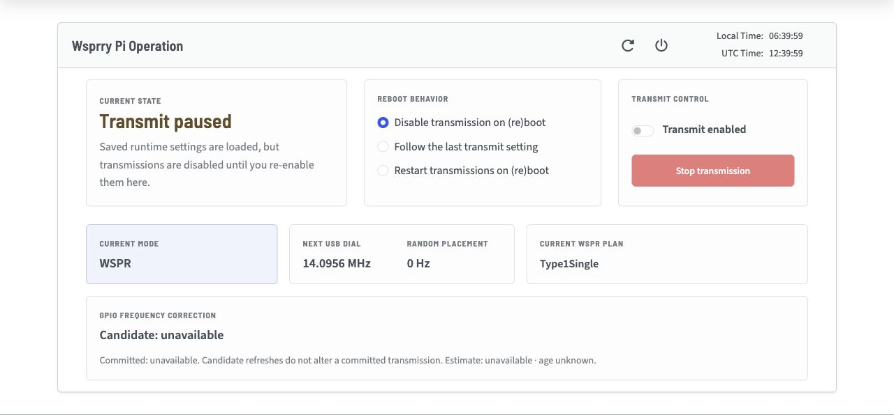

# Operations Card

The **Operation** page is the main view for monitoring transmissions.

## Select a Fleet output

When an assigned Pi or Pico exists, the **Device** selector appears beside the Operations heading. It also includes removed outputs whose cleanup remains unresolved. A saved device profile alone does not add an output. **This Pi (controller)** is selected whenever the page opens. Selecting another output changes this view only; it does not change configuration, ownership, the single selected WTP backend or any schedule.

The selected device's name and full identity stay beside its status. **Schedule enabled** and **Schedule paused** describe its assigned schedule. **Running** requires matching device job evidence; a countdown reaching zero does not establish execution. Intentional output-off intervals can occur inside a running job. Device observations and requested/realized frequency values are software reports, not measured RF or frequency qualification. Plain LAN's expected identity match is not authentication.

Device observations become stale at 15 seconds. Their age continues increasing if refresh fails; a refreshed page does not make an old observation current. A healthy new context receives one read-only inspection. A failed connection requires explicit **Reconcile**; opening Operations or changing Device does not reconnect, claim output, set a clock or start a transmission. **Other job on device** identifies work outside this assignment and never offers takeover.

Use **Resume schedule** only after reviewing fresh, inactive, unowned status and the saved schedule. Resume schedules future eligible occurrences and does not replay an interrupted slot. **Pause and stop** confirms the selected device and disables this controller's schedule while stopping its owned work. A confirmed schedule pause alone does not mean the device stopped: another job can remain active, or its output can be unknown. **Reconcile** reports its own result and leaves the schedule paused. **Edit schedule** opens the existing Fleet editor with the selected assignment; unsaved entries retain their original target and revision.

Acceptance and completion are separate. Read the action feedback beside the controls. After a timeout or an unconfirmed outcome, use **Read status**, review the current state, and reconcile outstanding work before another start. **Review current state** acknowledges the current readback without rewriting an earlier unknown action as successful. Changing Device preserves pending action tracking. A replaced or removed assignment remains visibly removed until acknowledged; it never silently selects another target.

Controller reboot, shutdown and reboot-behavior controls are hidden while a remote output is selected. The connection indicator and header clocks still describe the controller. With **This Pi** selected, the existing local controls apply; when its backend is WTP, those controls operate the configured endpoint rather than physical output on the controller.

## Initial Operations

When you open the user interface at `http://{servername}.local`, the Apache configuration redirects to `http://{servername}.local/wsprrypi/`.  This configuration is in place to avoid a conflict with any other websites you may have on your system.  If the installer detects another website in the root, the redirect is disabled, and you need to append the `/wsprrypi/` manually.

Before enabling transmission, complete [the first-transmission checklist](../../first_transmission.md).
On Raspberry Pi 5-family systems, a fresh installation leaves both GPIO routes
unselected and output disabled. Choose and apply GPIO4 or GPIO20 under
**Setup → Transmitter**, or configure the Si5351 backend. Follow
[Transmitter Configuration](../Setup/Transmitter/index.md) and confirm the
requested and active hardware agree before proceeding.

The card shows the current state and transmission plan, with controls to enable, disable, or stop transmissions.

- **Current State:** Gives you a color and textual representation of what the Pi is doing right now. If you are configured with valid parameters and transmissions are enabled, you see "Ready"

- **Reboot Behavior:** 

  - *Disable transmission on (re)boot* means that any time the daemon is restarted (which includes a reboot), the transmission state is disabled.  This is provided to protect against unexpected transmissions and potential damage to any PA finals.
  - *Follow the last transmission setting* takes the transmission control from the last known state, and follows accordingly on daemon restart,
  - *Restart transmission on (re)boot* enables transmissions, if the system can honor the configuration, when the daemon restarts.

  These choices control whether transmission is requested after startup. They do not bypass startup hardware safety. Before WsprryPi starts its web and socket services or creates a transmission schedule, it places the selected transmitter backend in a disabled state:

  - For the **Si5351** backend, all clock outputs are disabled.
  - For the **GPIO** backend, the DMA and clock path are stopped, and the selected transmit GPIO is returned to an input state.

  If WsprryPi cannot confirm this safe state, it inhibits every transmission path for the lifetime of that daemon process. The web interface remains available for diagnosis, but changing the transmission switch, reloading the configuration, or changing modes does not clear the inhibition. Correct the hardware or configuration problem and restart the WsprryPi service so the startup safety check can run again.

  The startup check runs when the WsprryPi daemon starts; it cannot control transmitter hardware before the daemon is running. Stations that require guaranteed RF inhibition throughout power-up should also use an independent hardware inhibit or power-control circuit.

- **Transmission Controls:** This panel contains a switch to enable or disable transmissions as well as an emergency stop.

  - *Transmit Enabled* switch enables or disables the transmission scheduler.  When enabled, the transmitter operates on the schedule you have configured.  If you disable it, the configuration saves immediately; any in-progress transmission finishes.
  - *Stop transmission* halts an ongoing transmission immediately and disables future transmissions. It is only enabled during a transmission.

- **USB dial / Next USB dial:** The WSPR panel displays the current or next USB dial frequency. RF center = dial + 1500 Hz + optional random placement. The standard 20m dial is 14,095,600 Hz, and its RF center without random placement is 14,097,100 Hz. **Random placement** shows the signed WSPR offset in Hz, separately from the fixed 1,500 Hz placement. CW labels identify **Carrier** for QRSS, **Space** for FSKCW, and **Dot** for DFCW; **Positive shift** gives the mark or dash offset. These values describe requested frequencies, not measured RF.

    If a GPIO LPF pin is configured, that pin and the active high/low status are displayed after the frequency.

- **Current Plan** or **Message Progression** shows the current plan to be transmitted, or the next plan in pause mode. For WSPR modes, it shows the WSPR frame type being transmitted, along with the callsign and locator. For CW modes, it shows the message and a cursor for the character being transmitted.

  - *Type1Single* is a standard Type 1 WSPR frame.
  - *Type2Single* sends a supported compound callsign, such as one with a prefix (`W0/`) or suffix (`/P`), and reported power. It does not carry a locator.
  - *Type1Type3Paired* alternates Type 1 (shown as F1/2) and Type 3 (shown as F2/2) messages, pairing a simple callsign with a long locator so the receiver can associate both.
  - *Type3Single* sends three things: a callsign hash, a six-character Maidenhead locator, and reported power. The receiver can’t recover the callsign from the hash alone. It needs matching callsign information from another message it has decoded.
  - *Type2Type3Paired* alternates between Type 2 (shown as F1/2) and Type 3 (shown as F2/2) messages. Together, the two frames let the receiver associate a complex or long callsign with a long locator.
  - *Next Message At* is displayed when in one of the three CW modes and the scheduler is waiting for a transmission window.  The time is displayed in the local time.
  - *Message Progression* is displayed in CW mode during a transmission. It shows a cursor on the current character.
