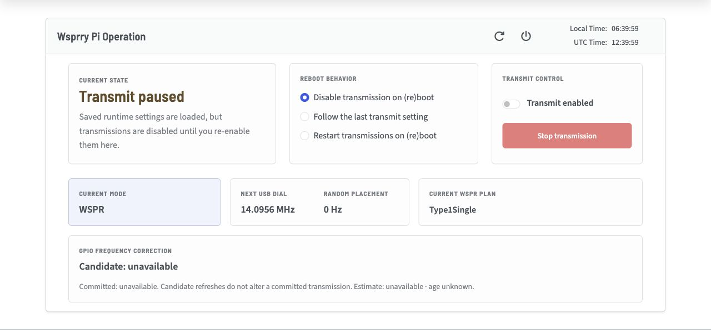

# Operations Card

The **Operation** page is the main view for monitoring transmissions.

Native device-owned scheduling has an independent enable state, managed under [Setup → Scheduling](../Setup/Scheduling/index.md). Turning that state off allows an accepted complete occurrence to drain and keeps output ownership. The existing Transmit and Stop controls retain their separate permission and cancellation behavior. A solar wait is normal waiting; a forecast or countdown alone does not establish execution.

## Manage another transmitter

Use **Device** beside the Operations heading to select a paired WsprryPi, a supported saved WsprryPico, or a supported Pico attached to a paired Pi. **This Pi (controller)** is the initial selection on a transmitter installation. Selecting another device reads its status without changing settings, enabling transmission, or changing this Pi’s transmitter backend.

On a transmitter installation, **Device** is hidden when **This Pi (controller)** is the only choice. Pair another Pi through [Maintenance → Controller access](../Maintenance/index.md#controller-access), or enroll a Pico under [Setup → Fleet](../Setup/index.md#pi-and-pico-fleet-setup), to make it available. Nearby advertisements alone do not provide Operations controls. A controller-only installation shows **Controller (no local output)** instead of local transmitter controls.

Confirm the selected device’s name and full identity above its status. The page shows that device’s reported state, output or Transmit permission, schedule observations, and last-read time. These are software observations, not measurements of RF output. Header clocks still belong to the controller, and its local transmitter and power controls are unavailable while another device is selected.

Use **Edit device settings** to open the same device under [Setup → Device](../Setup/index.md#choose-and-edit-a-device). Its settings and schedule remain independent of this Pi. Closing the controller’s browser does not stop a device-owned schedule.

### Paired Pi controls

Available controls depend on the selected Pi’s supported capabilities and a verified read:

- **Read status** reads current settings and status from the selected Pi.
- **Enable transmission** turns on that Pi’s saved Transmit permission. Recurring transmissions also require its saved schedule to be enabled.
- **Enable saved schedule** enables the saved schedule without changing Transmit permission.
- **Pause schedule** prevents new scheduled occurrences while accepted work may finish.
- **Stop transmission** stops output and turns off that Pi’s saved Transmit permission. Schedule enablement remains separate; read the resulting status before operating again.

Each change asks for confirmation naming the device it will affect. A Pi without supported transmitter settings remains a status-only view; select its supported attached Picos separately to operate them.

While a change remains unconfirmed, further changes are disabled. Use **Check earlier request** to check the earlier result without repeating the write. If the outcome remains unknown, select **Read current values for review**, compare the displayed values with the intended change, and then select **I reviewed these values**. Review allows a later deliberate action; it does not turn an unknown earlier outcome into success. Switching devices keeps an unfinished request associated with its original device.

### Pico controls

Use **Read status** to read the selected Pico’s output and native schedule observations. **Stop native schedules** disables both WSPR and keyed-message schedules and requires readback confirming inactive, unowned output. If Stop is refused or unconfirmed, use **Read stop status** before another action. An ordinary status read does not clear the hold, and a different boot cannot confirm the earlier stop. Use the Pico’s local recovery controls if it cannot be reached.

Enable or edit WSPR scheduling under [Setup → Scheduling](../Setup/Scheduling/index.md). Keyed-message schedule enablement uses the Pico’s own controls.

### Unavailable devices and legacy history

If the selected device disappears or its profile changes, its output state becomes unknown and controls remain unavailable. Return to **This Pi (controller)** or **Controller (no local output)** and choose a current device explicitly. A failed connection does not confirm that output stopped.

Entries labeled **legacy history** show retained controller-assignment and migration records. They do not operate the device’s current native schedule. Use the current managed-device entry for status and supported controls.

## Initial Operations

When you open the user interface at `http://{servername}.local`, the Apache configuration redirects to `http://{servername}.local/wsprrypi/`.  This configuration is in place to avoid a conflict with any other websites you may have on your system.  If the installer detects another website in the root, the redirect is disabled, and you need to append the `/wsprrypi/` manually.

Before enabling transmission, complete [the first-transmission checklist](../../first_transmission.md). On Raspberry Pi 5-family systems, a fresh installation leaves both GPIO routes unselected and output disabled. Choose and apply GPIO4 or GPIO20 under **Setup → Transmitter**, or configure the Si5351 backend. Follow [Transmitter Configuration](../Setup/Transmitter/index.md) and confirm the requested and active hardware agree before proceeding.

With **This Pi (controller)** selected, the card shows this Pi’s current state and transmission plan, with controls to enable, disable, or stop transmissions.

- **Current State:** Gives you a color and textual representation of what the Pi is doing right now. If you are configured with valid parameters and transmissions are enabled, you see "Ready"

- **Reboot Behavior:** 

  - *Disable transmission on (re)boot* means that any time the daemon is restarted (which includes a reboot), the transmission state is disabled.  This is provided to protect against unexpected transmissions and potential damage to any PA finals.
  - *Follow the last transmission setting* takes the transmission control from the last known state, and follows accordingly on daemon restart,
  - *Restart transmission on (re)boot* enables transmissions, if the system can honor the configuration, when the daemon restarts.

  These choices control whether transmission is requested after startup. They do not bypass startup hardware safety. Before WsprryPi starts its web and socket services or creates a transmission schedule, it places the selected transmitter backend in a disabled state:

  - For the **Si5351** backend, all clock outputs are disabled.
  - For the **GPIO** backend, the DMA and clock path are stopped, and the selected transmit GPIO is returned to an input state.

  If WsprryPi cannot confirm this safe state, it inhibits every transmission path for the lifetime of that daemon process. The web interface remains available for diagnosis, but changing the transmission switch, reloading the configuration, or changing modes does not clear the inhibition. Correct the hardware or configuration problem and restart the WsprryPi service so the startup safety check can run again.

  The startup check runs when the WsprryPi daemon starts; it cannot control transmitter hardware before the daemon is running. Stations that require guaranteed RF inhibition throughout power-up should also use an independent hardware inhibit or power-control circuit.

- **Transmission Controls:** This panel contains a switch to enable or disable transmissions as well as an emergency stop.

  - *Transmit Enabled* permits or prevents output. The saved schedule must also be enabled under **Setup → Scheduling** before recurring transmissions can run.  If you disable it, the configuration saves immediately; any in-progress transmission finishes.
  - *Stop transmission* halts an ongoing transmission immediately and disables future transmissions. It is only enabled during a transmission.

- **USB dial / Next USB dial:** The WSPR panel displays the current or next USB dial frequency. RF center = dial + 1500 Hz + optional random placement. The standard 20m dial is 14,095,600 Hz, and its RF center without random placement is 14,097,100 Hz. **Random placement** shows the signed WSPR offset in Hz, separately from the fixed 1,500 Hz placement. CW labels identify **Carrier** for QRSS, **Space** for FSKCW, and **Dot** for DFCW; **Positive shift** gives the mark or dash offset. These values describe requested frequencies, not measured RF.

    If a GPIO LPF pin is configured, that pin and the active high/low status are displayed after the frequency.

- **Current Plan** or **Message Progression** shows the current plan to be transmitted, or the next plan in pause mode. For WSPR modes, it shows the WSPR frame type being transmitted, along with the callsign and locator. For CW modes, it shows the message and a cursor for the character being transmitted.

  - *Type1Single* is a standard Type 1 WSPR frame.
  - *Type2Single* sends a supported compound callsign, such as one with a prefix (`W0/`) or suffix (`/P`), and reported power. It does not carry a locator.
  - *Type1Type3Paired* alternates Type 1 (shown as F1/2) and Type 3 (shown as F2/2) messages, pairing a simple callsign with a long locator so the receiver can associate both.
  - *Type3Single* sends three things: a callsign hash, a six-character Maidenhead locator, and reported power. The receiver can’t recover the callsign from the hash alone. It needs matching callsign information from another message it has decoded.
  - *Type2Type3Paired* alternates between Type 2 (shown as F1/2) and Type 3 (shown as F2/2) messages. Together, the two frames let the receiver associate a complex or long callsign with a long locator.
  - *Next Message At* is displayed when in one of the three CW modes and the scheduler is waiting for a transmission window.  The time is displayed in the local time.
  - *Message Progression* is displayed in CW mode during a transmission. It shows a cursor on the current character.

## Device-owned scheduling

Use [Setup → Scheduling](../Setup/Scheduling/index.md) for the selected Pi’s schedule permission and solar policy. Verify the execution owner and output destination there. Disabling scheduling prevents new admissions while accepted work may finish. Transmit and immediate Stop remain separate controls; a disconnected observation cannot establish that output stopped.
