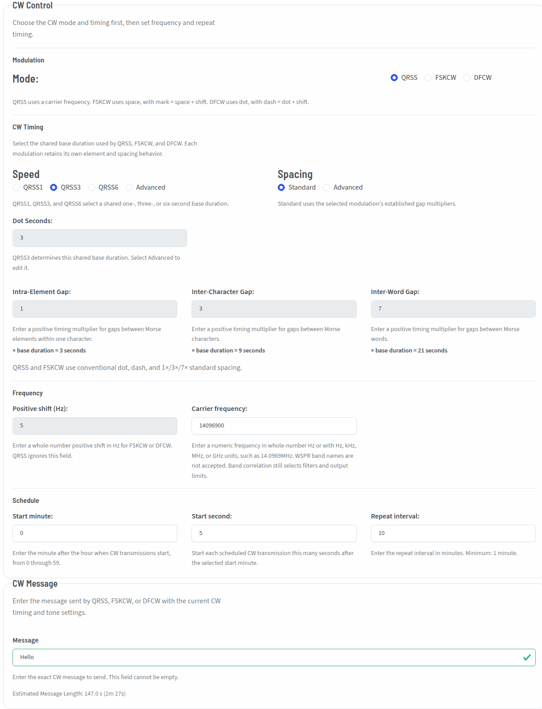

# Configure CW Modes

Use this page to configure QRSS, FSKCW, or DFCW timing, frequency, scheduling, and message content. Return to the [Signal Setup overview](index.md) to choose WSPR. For direct shell operation, see [CW Mode Options](../../../Command_Line_Operations/cw_modes.md); for direct file editing, see [INI Configuration Reference](../../../Advanced_Operations/ini_configuration.md); for recoverable save failures, see [Configuration Troubleshooting](../../../Advanced_Operations/configuration_troubleshooting.md).

CW Mode, using one of QRSS, FSKCW, or DFCW, was added as of version 3 of WsprryPi.  It offers some new exciting methods of QRP transmissions.

CW modes are not as strictly formatted, and are **not** a beacon mode as WSPR is.  Radio beacons send continuous, automated, unattended, one-way transmissions without specific reception targets. In contrast, QRSS transmitters are only intended to be transmitting when the control operator is available to control them, and the recipients are known QRSS grabbers around the world.

## Mode

The Mode panel allows configuring most of the metadata for CW modes.

### Available Modes

The actual CW mode is one of:

- **QRSS** - QRSS is extreme slow speed CW, the name is derived from the Q-code QRS (reduce your speed).  This mode, when displayed on a grabber's screen, is the most "CW-looking" of all the modes, with familiar dots and dashes.
- **FSKCW** - FSKCW means Frequency Shift Keying CW.  Instead of activate/deactivate the carrier, the carrier is always activated as long as the transmission lasts. During pauses between dots, dashes or characters the frequency is shifted downwards.  The upper trace shown on the screen contains the morse information, the lower trace is drawn during signal pauses.
- **DFCW** - DFCW means Dual Frequency CW.  DFCW mode was developed that enhances the average speed in LF transmissions (more impacted by QRN) by a factor of 2.5 to 3. In DFCW the element *duration* is replaced by the element *frequency*. Dots and dashes do not have a different length but they are transmitted on a different frequency. Due to this frequency shift there is no space needed between the dots/dashes and the character space can be reduced to the same dot length. The standard intra-element spacing multiplier is `0.333333`.

## CW Timing

The **CW Timing** controls set a shared base duration and the spacing used by the selected modulation.

### Speed

**QRSS1**, **QRSS3**, and **QRSS6** select a shared base duration, **T**, of 1, 3, or 6 seconds. Select **Advanced** to use a custom base duration. **Dot Seconds** is editable only while **Advanced** is selected.

The selected base duration applies to QRSS, FSKCW, and DFCW. The three modulations construct their elements differently:

| Modulation | Dot | Dash |
| --- | ---: | ---: |
| QRSS | `T` | `3T` |
| FSKCW | `T` | `3T` |
| DFCW | `T` | `T` |

### Spacing

**Standard** applies the established spacing values for the selected modulation. **Advanced** permits editing the active modulation's spacing triplet. Each value is a multiplier of the shared base duration.

QRSS and FSKCW share one conventional spacing triplet. DFCW has a separate spacing triplet:

| Spacing | QRSS and FSKCW | DFCW |
| --- | ---: | ---: |
| Intra-element | `1` | `0.333333` |
| Inter-character | `3` | `1` |
| Inter-word | `7` | `3` |

The DFCW intra-element value is the persisted decimal `0.333333`.

Changing **Modulation** displays the corresponding spacing triplet; it does not replace or reset the inactive triplet. If an inactive triplet contains a preserved invalid value, the save status shows **Invalid - not saved** with either **Review QRSS/FSKCW spacing** or **Review DFCW spacing**. Select that review action to display and correct the preserved values. Autosave resumes after all three values are valid; use **Close** to hide the repaired inactive triplet.

### Modulation construction

- **QRSS** transmits a dot for `T` and a dash for `3T` at the base frequency. Its spacing uses the QRSS/FSKCW triplet.
- **FSKCW** transmits its mode-specific dot and dash tones for `T` and `3T`. Its spacing also uses the QRSS/FSKCW triplet.
- **DFCW** transmits every dot and dash for `T`. Frequency distinguishes the two elements, and its spacing uses the separate DFCW triplet.

### Positive shift

Enter a positive whole-number shift in Hz. FSKCW mark = space + shift; DFCW dash = dot + shift. This control is disabled in QRSS. FSKCW retains its space carrier between elements; QRSS and DFCW gaps have RF off. Timing and gap controls remain independent of the frequency reference.

### Carrier, space or dot frequency

The label follows the selected mode: **Carrier frequency** for QRSS, **Space frequency** for FSKCW, and **Dot frequency** for DFCW. Enter whole-number Hz, such as `14096900`, or use Hz, kHz, MHz or GHz units, such as `14.0969MHz`. WSPR band aliases are rejected. Changing the mode changes the reference label while preserving the entered frequency. Band correlation remains in use for filter selection, frequency policy and output limits.

### Frequency calibration

CW uses the selected transmitter backend's frequency-correction settings. Configure those settings under [Transmitter](../Transmitter/index.md); they correct reference-clock error and do not replace the carrier, space, dot or positive-shift values. A remote WTP transmitter owns its correction; supplied absolute RF targets do not receive Pi calibration again. Use an independently calibrated receiver when measuring RF. See [Transmission Timing and Calibration](../../../Advanced_Operations/timing_calibration.md).

## Schedule

### Start minute / Start second / Repeat interval

QRSS operators generally start at minute 0 and repeat every 10 minutes. **Start minute** selects the minute after the hour. **Start second** accepts a whole number from `0` through `59` and offsets each scheduled QRSS, FSKCW, or DFCW transmission from that minute. Its default value is `5`, and an explicit value of `0` is valid. **Repeat interval** sets the cadence in minutes; the start-second offset does not change that interval or the calculated message duration. The repeat interval must also be long enough for the complete CW message. A transmission may take exactly the full repeat interval, but it may not run longer than that interval.

## CW Message

### Message validation

Enter the text to transmit in the **Message** field. Setup updates the **Estimated Message Length** when you edit the message or change:

- the selected QRSS, FSKCW, or DFCW mode;
- the dot length or speed;
- the active spacing values;
- the repeat interval.

Changing the repeat interval reevaluates whether the estimated duration fits within the transmission window; it does not change the calculated message duration itself.

Only the active spacing controls affect the estimate. QRSS and FSKCW use their shared spacing values, while DFCW uses the DFCW spacing values.

(cw-message-too-long)=

#### When a CW message is too long

If the estimated message length exceeds the repeat interval, Setup keeps the draft in the Message field but does not save it. The Message field is marked invalid, and the Setup header displays a persistent **Save failed** status. The detail reports the calculated message duration and configured repeat interval, then identifies the available corrections.

Autosave remains paused while the message is too long. Further edits that remain over the limit update the estimate and keep the inline failure visible; they do not repeatedly open the general configuration reload-failure dialog.

To correct the configuration, use one or more of these options:

- Shorten the message.
- Reduce the dot length or select a faster speed.
- Reduce the spacing values used by the selected mode.
- Increase the repeat interval.

Setup clears the duration error and resumes autosave automatically as soon as the estimated message length is less than or equal to the repeat interval. A duration equal to the repeat interval is valid.

Enter supported CW text in the **Message** field. Numeric-looking text such as `73` is a valid CW message.

An empty message or a message containing an unsupported character is a separate validation error. Correct the message shown in the field; clearing a duration error does not make an empty or unsupported message valid.