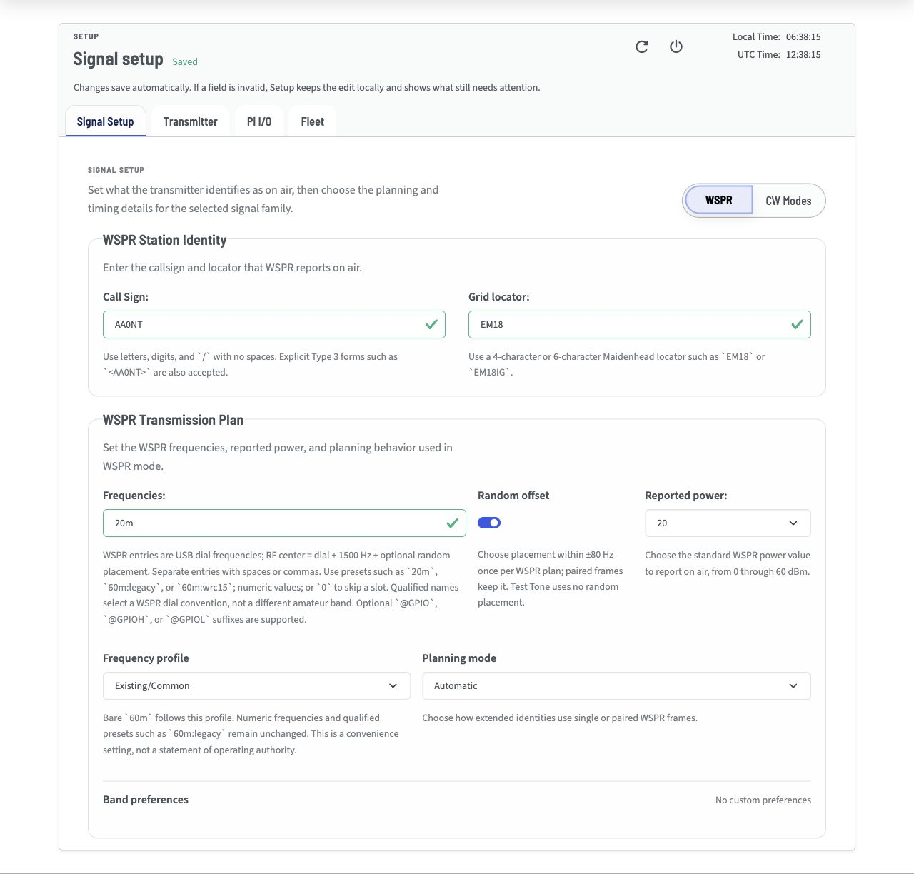

# Signal Setup Tab

Use the Signal Setup tab to configure the signal type and message content.



This tab has two main modes, WSPR and CW.

Select your preferred mode to show its settings.

Choose the mode you want to configure:

```{toctree}
:maxdepth: 1
:hidden:

Configure WSPR <wspr>
Configure CW Modes <cw>
```

## Signal Configuration Guides

<span id="wspr-mode"></span>
<span id="station-identity"></span>
<span id="wspr-transmission-type-selection-examples"></span>
<span id="rule-summary"></span>
<span id="wspr-transmission-plan"></span>
<span id="frequencies"></span>
<span id="random-offset"></span>
<span id="reported-power"></span>
<span id="frequency-calibration-ppm-ntp-calibration"></span>
<span id="planning-mode"></span>

- [Configure WSPR](wspr.md) for station identity, WSPR message planning, frequencies, reported power, and calibration.

<span id="cw-mode"></span>
<span id="mode"></span>
<span id="available-modes"></span>
<span id="cw-timing"></span>
<span id="speed"></span>
<span id="spacing"></span>
<span id="modulation-construction"></span>
<span id="frequency-offset"></span>
<span id="base-frequency"></span>
<span id="frequency-calibration"></span>
<span id="schedule"></span>
<span id="start-minute-start-second-repeat-interval"></span>
<span id="cw-message"></span>
<span id="message-validation"></span>
<span id="when-a-cw-message-is-too-long"></span>
<span id="cw-message-too-long"></span>

- [Configure CW Modes](cw.md) for QRSS, FSKCW, and DFCW modulation, timing, spacing, scheduling, frequency, and message validation.

If your task concerns the RF output path or Raspberry Pi pins rather than signal content, use [Configure Transmitter](../Transmitter/index.md) or [Configure Raspberry Pi I/O](../Pi_IO/index.md).
