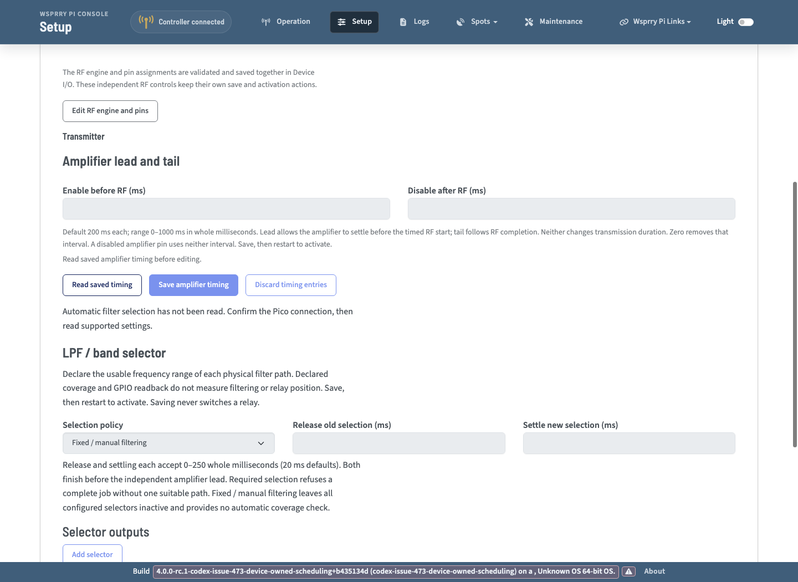
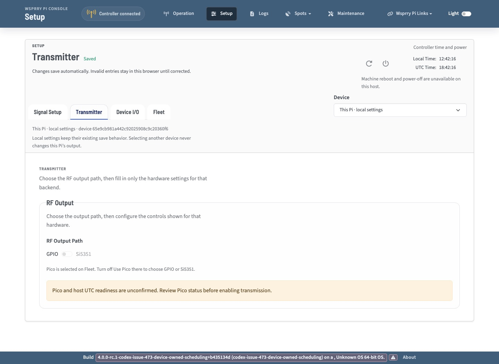

# Transmitter Configuration Tab

Choose **Device** beside the tabs first. **This Pi** retains the local backend settings below. A saved Pico exposes its supported independent Si5351, amplifier timing, filter, and GPIO-drive resources with explicit reads and saves. Its complete engine/pin/GPS plan is under **Device I/O**; **Edit RF engine and pins** takes you there. Selection never changes an output backend.

A paired Pi uses the same tabs with its own explicit **Read saved settings** and **Save this Pi’s settings** controls. Read its settings and verify its identity before editing output, calibration, or band GPIO values. The selected Pi’s draft stays separate from local autosave. A Pico attached to a managed Pi uses that Pi’s existing connection automatically; selecting it does not switch this controller’s output. See [Choose and edit a device](../index.md#choose-and-edit-a-device) for saved-result recovery and retained drafts.

The Transmitter tab on the Signal Setup page contains settings related to the active output hardware path and transmission behavior.

Use the **RF Output Path** switch to choose between GPIO and Si5351. The switch shows GPIO on the left and Si5351 on the right; switch it off for GPIO or on for Si5351. The same RF Output panel then shows only the settings for that hardware. On wide screens, those controls share one row. On smaller screens, they wrap or stack without changing their order.

- **GPIO** - Available on earlier Raspberry Pi models and on Pi 5 when the installer-managed RP1 GPCLK provider and selected route are eligible.
- **Si5351** - If detected, the Si5351 may be used on any supported Raspberry Pi.

## Recover saved settings

If saved transmitter settings prevent startup, **Setup** shows **Recover saved settings**. Transmission controls remain unavailable until startup is verified. The displayed values are an unconfirmed draft. Opening the page or editing a field does not save anything.

Correct the reported values, then choose **Save corrected settings**. Choose **Repair missing settings** to retain compatible saved values and fill missing settings from the installed defaults. **Restore default settings** requires a separate confirmation and replaces the saved settings. Review the station, output, and enable-on-boot settings before saving. After a valid save, normal startup resumes using the saved enable-on-boot policy.

Recovery remains restricted to eligible local-network clients even when **Network Safety** is saved as Off. Saving retains that preference. Recovery access does not enable the other protected management controls while it is Off.

If a save result is unconfirmed, keep the page open and use **Check saved result**. Further changes remain drafts while that result is unresolved. A successful startup alone does not confirm the save receipt. If you edited more values while waiting, returning to ordinary Setup requires explicitly discarding those later edits. Reloading or leaving the page loses unsaved drafts.

**Read-only recovery** means saved history or startup could not be verified. Save, Repair, and Restore defaults are unavailable; Restore defaults cannot erase that history. Preserve the saved files and resolve the reported startup or storage problem before attempting another change.

## GPIO

GPIO-based transmissions are the typical method most people think of when they think of WsprryPi.  It uses a GPIO Pin attached to a clock generator on the Pi to transmit WSPR tones.

On Pi 5-family systems, a fresh installation supplies and validates the RP1 GPCLK provider and establishes neutral administration with no route selected. An update can restore an explicitly saved `rp1-gpclk` GPIO4 or GPIO20 route after neutral activation, with transmission disabled. A retained GPIO pin for another backend is not route consent. Installation alone does not qualify either route or authorize transmission.

GPIO qualification depends on the processor clock profile, band, and mode. Use the accepted [band qualification table and numbered notes](../../../About_Wsprry_Pi/index.md#band-qualification). Unqualified combinations are blocked by default in scheduled operation and Test Tone; an experimental override cannot enable an Unavailable plan. Si5351 has its own qualification. See [GPIO Band Capabilities and Signal Quality](../../../FAQ/why_12m_looks_noisy.md) for the retained signal-quality evidence.

The output controls select the transmit pin and drive; frequency calibration is described [below](#gpio-frequency-correction-feedback).

### Transmit Pin

GPIO4 and GPIO20 are the supported direct RF output choices. The selected pin is reserved by the GPIO backend even when transmission is disabled, because WsprryPi must retain ownership of the configured RF path for startup and safe-state handling.

On Pi 5, the route panel distinguishes **Requested** from **Active**. Selecting the other pin or None creates a draft; it does not autosave or redirect committed work. When the transmitter is completely idle, choose **Switch route** for GPIO4 or GPIO20. Choose **Remove route** for None. Choose **Cancel** to restore the persisted selection without changing the Pi.

Switching and removal happen in the current boot and do not require a reboot. The status dialog remains visible through the brief controller disconnect and checks the result without repeating the operation. If WsprryPi was running, successful removal brings it back online and idle. A service that was already stopped or administrator-masked remains stopped or masked.

The panel distinguishes checking, plan ready, switching, restoring, route selected, removing, route removed, service stopped, restoration failed, and recovery-required states. Transmission remains disabled during an unresolved transaction. **Recover to no route** is an exceptional fail-closed action: it leaves WsprryPi stopped and the controller inhibited for investigation. Use **Remove route** for normal removal. See [Raspberry Pi 5 RP1 GPCLK](../../../Advanced_Operations/rp1_gpclk.md) for recovery guidance.

WsprryPi permits RP1 transmission only when the route and eligibility evidence agree exactly.

The other pin remains available on the **Device I/O** tab. Selecting the Si5351 backend releases both GPIO4 and GPIO20 for ordinary GPIO roles; the retained GPIO transmit-pin value is ignored while Si5351 is selected.

If an existing configuration assigns the selected RF pin to an enabled ordinary GPIO role, both controls remain visible and are marked invalid until one assignment is changed or disabled. Invalid edits are not saved.

### GPIO Power Level

These are output driver strength levels mapped within the Pi's GPIO registers.  You may adjust the output from 0-7 with the slider.  The values roughly align to power levels at the pin before any amplification or filtering:

1. 2 mA: ~-7.0 dBm
2. 4 mA - ~-1.0 dBm
3. 6 mA - ~2.6 dBm
4. 8 mA - ~5.1 dBm
5. 10 mA - ~7.0 dBm
6. 12 mA - ~8.6 dBm
7. 14 mA - ~9.9 dBm
8. 16 mA - ~11.1 dBm

Actual output should be measured with the entire circuit and antenna.

## Si5351

The Si5351 is selectable on all supported Pi models. Discovery establishes register communication only. Unchecked or failed discovery leaves presence unconfirmed; a completed scan with no compatible response is a different result. Neither a responding address nor successful initialization proves RF readiness under every operating condition.

### I2C adapter

Select an adapter exposed by Linux with a corresponding I2C device. A USB entry retains its stable identity and shows the current `/dev/i2c-N` node. MCP2221A requires this stable selection. Generic numeric-bus settings remain available for other adapters. An unavailable or ambiguous saved identity stays visible and blocks use; WsprryPi never selects an arbitrary identical adapter. Reload after reconnecting to refresh the resolved node.

Serial identity includes VID/PID. Without a serial, selection is tied to the host's USB topology; moving the adapter may require explicit reselection. The [Linux USB I2C setup](../../../Install/linux_si5351.md) covers the reference hardware, permissions, capability checks, and recovery limits. Listing confirms metadata presence only, not access, wiring, or physical qualification.

### I2C Address

Selecting Si5351 or loading it as the active backend requests fresh inventory after the saved bus/address is populated. Stable-identity selection probes only the selected address. If it does not respond, choose the board's fitted address from **I2C Address** to check that address explicitly. The control remains editable after a failed check; a single-address result does not describe the whole range. Valid address changes use the form's normal autosave. For a generic numeric bus, WsprryPi checks only `0x60` through `0x6F`. Ordinary configuration and status reads use cached observations; they do not scan an inactive Si5351 merely to fill the form.

The scan has a two-second deadline plus at most 25 ms of cleanup attempts. Unchecked, checking, busy, timeout/error, and confirmed no compatible response are distinct states. Busy or failed discovery keeps the saved address visible as **unconfirmed**; timeout does not mean missing hardware. A completed scan that does not find the saved address requires an explicit detected selection.

Wait for an outstanding worker to exit before retrying a busy scan. After a communication failure, correct the reported bus, wiring, power, or permissions problem, then select the bus again or reload to request another bounded scan. Saving a newly selected bus/address independently validates it on the server; the browser's cached list is not authority to use it.

The standard Si5351 address is `0x60`; some boards support `0x61`, and compatible devices or clones may use another address in the supported range. The Si5351 does not provide a definitive silicon-identification register, so a listed address means that a register-compatible device responded. Verify the attached hardware before transmitting.

### Reference Frequency

You must configure the reference frequency installed on the clock-generator board. QRP Labs synthesizer kits are supplied with a 27 MHz crystal and support optional TCXO configurations; Adafruit breakout boards use a 25 MHz crystal. Either reference can generate many supported frequencies.

For qualified 2 m WSPR operation, use a 27 MHz reference. [QRP Labs selected 27 MHz](https://qrp-labs.com/images/synth/synth_assembly6.pdf) because its synthesis calculations preserve WSPR tone spacing through 145 MHz, while its 25 MHz configuration does not. WsprryPi's current planner can calculate the four 2 m tones from a 25 MHz reference, but WsprryPi has physically qualified only its 27 MHz reference configuration on 2 m. A 25 MHz reference therefore remains unqualified for 2 m rather than proven incompatible.

Enter the frequency that corresponds to the installed reference hardware.

### Reference Source

Choose **External clock / TCXO** for a module driven by an active reference. This is the default and preserves existing behavior. Choose **Passive crystal** only when a crystal is connected across the Si5351 XA/XB pins.

When **Passive crystal** is selected, the **Crystal Load Capacitance** menu appears with 6, 8, and 10 pF choices. Select the value specified for the installed crystal; 10 pF is the default. The menu is hidden and its value is not programmed when **External clock / TCXO** is selected.

### Si 5351 Power Level

Levels **1, 2, 3, 4** retain **2, 4, 6, 8 mA** output drive, respectively. These are drive settings, not calibrated RF power. Measure the complete filtered and loaded RF path independently; WSPR reported dBm does not set this drive.

### Readiness and recovery

Initialization waits for the device's initialization status before ordinary programming. A later PLL/reference readiness fault or transport error during execution ends that work and attempts output inhibition. Read the reported phase and cleanup result: an I2C failure is different from a valid non-ready status. Failed disable/readback leaves output uncertain and further output inhibited.

Keep transmission disabled, resolve the reported hardware or configuration problem and establish exclusive ownership before recovery. Use the existing stop/quiescence workflow; startup-inhibited processes require a service restart after repair. Verify the resulting status before deliberately starting new work. Recovery does not automatically resume the interrupted transmission. Startup attempts to inhibit all Si5351 outputs; accepted writes or register readback are not a measured RF-off guarantee.

CW fades switch the selected output on and off at its retained full drive. They approximate an envelope by duty cycle; they do not vary analog amplitude. See [CW envelope control](../../../Command_Line_Operations/cw_modes.md#envelope-control) for slice/deadline limits and measurement boundaries.

## GPIO frequency correction feedback

**Frequency calibration** separates **System clock estimate**, **Residual PPM**, and **Fallback PPM**. Candidate correction describes what a future request would use. Committed correction belongs to the already prepared work and stays fixed even when a newer estimate arrives or settings are saved. Displayed effective/correction PPM is the additional term; chipset intrinsic compensation is applied separately once.

Read the selected correction mode as well as estimate qualification. A currently unavailable or converging report can still use a bounded prior-qualified value. **age unknown** means freshness could not be established; it is different from **age 0 s**. Source provenance describes selected/combined Chrony records, not verified GNSS lock or measured RF accuracy. See [Transmission Timing and Calibration](../../../Advanced_Operations/timing_calibration.md) for intrinsic, residual, manual, and zero-additional accounting.

On Pi 1–4, **System clock estimate** uses Chrony's OS-level estimate of the shared board oscillator. GPS/PPS is optional and is configured in Linux/GPS services and Chrony; WsprryPi does not capture PPS directly on these hosts. Network time sources can also supply Chrony. See {ref}`Pi 1–4 host-frequency calibration <pi1-4-host-frequency-calibration>`.

On Pi 5 with the RP1 GPIO backend, **Direct PPS calibration** can replace the host estimate with an RF-clock measurement against an existing GPS PPS input on GPIO17. It is opt-in and requires a qualified reference and current local Chrony synchronization. Allow at least 30 seconds to settle. Acquisition and reference errors select **Fallback PPM**; accepted jobs retain their original correction. Review an existing residual when changing calibration sources. See {ref}`Transmission Timing and Calibration <direct-pps-calibration-on-pi-5>` for prerequisites, source ownership, uncertainty, and loss behavior. The {ref}`RP1 frequency-calibration results <direct-pps-rp1-results>` show measured host-estimate and direct PPS errors in both Hz and PPM.

## Add a Pico and manage outputs

Open **Setup → Fleet** to save a management profile, then choose that device under **Device**. Profiles never select this Pi’s RF backend or dispatch work. See [Fleet setup](../index.md#pi-and-pico-fleet-setup) for management connections and [Add a Pico](../../../Install/pico.md) for USB and network connection requirements.

(before-selecting-the-host-output)=
### Before selecting the host output

Choose a native Pi backend only for RF produced by this Pi. A Pico produces RF under its own native schedule, configured through its independent management connection.

(known-and-nearby-devices)=
### Known and nearby devices

Names and discovery hints are not identity. Confirm the full device ID and explicit connection before saving a profile. Management-only USB discovery uses interface 4 directly. Consumer Wi-Fi uses encrypted password authentication; Engineering HTTPS retains certificate/name verification.

### Install or update Pico firmware over USB

Use the independent [Pico installation workflow](https://wsprrypico.readthedocs.io/en/devel/install.html) for the exact attached device. Stop the device’s schedules before an update, retain recovery assets, and follow the installer’s exclusive-access checks. A saved management profile alone does not authorize maintenance.

### Pico status and recovery

In the selected Pico settings, use **Read device status** for a current native execution observation. **Stop native schedules** disables both saved schedules and confirms inactive, unowned output when successful. If stop is unconfirmed, use **Read stop status** before another deliberate action. A disconnect does not prove output-off. Use local USB Console recovery when management is unavailable. Settings drafts remain separate from stop and status.

### Pico standalone settings and Wi-Fi

Choose a saved Pico in the shared **Device** selector beside the Setup tabs. Fleet's **Manage settings** is a shortcut to that same selection. Open **Signal Setup** for station progress, **Scheduling** for WSPR recurrence, gray-line, and combined standalone settings, or **Device I/O** for connections. The **Pico settings** section identifies the device being edited. Confirm its full device ID and the saved **Device / boot** observations before saving. Management does not select this Pi’s output connection. A controller without a local transmitter can also manage Pico settings. These controls manage settings saved on the selected Pico for its own standalone application. They are separate from this Pi's settings, prepared jobs, output assignments, and saved connection profiles. A USB connection uses the Pico's paired USB management channel automatically. For network management, Engineering HTTPS uses the configured Network (TLS) credentials; supported consumer Wi-Fi or setup Wi-Fi uses an explicit login. A saved profile alone does not provide that login.

For direct field operation, the Pico’s **Wi-Fi/Host → Field access** setting keeps its protected AP available across restarts. Join that AP with the effective Pico control password, then authenticate in its browser page. With no usable higher-priority time source, the authenticated AP browser automatically supplies its device clock. **Using browser time** applies to a phone, tablet, or laptop. Keep the page active for refresh; holdover is limited to one hour, independently of NTP timeout settings. Estimated UTC uncertainty remains visible and does not impose an additional first-party transmission cutoff. Restart requires fresh time. These direct Pico controls do not transfer RF ownership to WsprryPi. See the [Pico field-access instructions](https://wsprrypico.readthedocs.io/en/devel/connect.html#field-access-without-internet).

Reads preserve current jobs and RF ownership. Each Pico checks whether a requested change is safe and can refuse changes while its own work is pending, owned, active, or unresolved. Resolve the stated condition on that Pico before saving. Leave **Enable Pico WSPR recurrence** cleared until you intend Pico to transmit autonomously and its clock and RF path are ready.

Managing another saved Pico keeps each device's entries on this page. Returning to the same saved profile requires fresh readback before another save. A changed or replaced profile keeps its old draft separate. Accepted requests remain listed under **Earlier settings requests** with their original device, even after the editor changes. Open **Retained drafts** to review entries from an inactive or replaced profile without restoring its connection or saving anything. Password contents are not displayed; enter them again in a current editor if needed. Keep the page open to retain unsaved entries.

In **Signal Setup**, use **Save station progress** under **Standalone station defaults** for independent station-field saves and separate application. **Complete station save** provides the complete three-field alternative. In **Device I/O**, open **RF output, GPS, and pins** for hardware settings; USB name and Wi-Fi have their own controls there. Management prerequisites appear before the editors; resolve the stated prerequisite before reading or saving settings.

#### Load and save settings

1. Confirm the selected Pico and its **Device / boot** observation. In **Scheduling**, open **Standalone schedules and combined settings**, then choose **Load saved Pico settings**. A normal load replaces the form's draft and clears any entered password. Status polling preserves the draft.
2. Edit the required fields. **WSPR power metadata (dBm)** is the reported WSPR power, not an RF output-drive control. **Time server** accepts an IPv4 address or a hostname supported by the Pico firmware.
3. Choose **Save combined settings** and read the result below the controls. Saving applies the changed settings together. An unchanged form reports that no settings changed and performs no save.

This combined form supports network management and firmware without the separate editors. Use station progress in Signal Setup and USB name/Wi-Fi in Device I/O for those scoped tasks. **Save combined settings** can change station, Wi-Fi, expiry, and WSPR recurrence as well as schedule entries.

Ordinary saves preserve settings outside this form, including Pico pin assignments and advanced frequency-policy settings. WsprryPi preserves supported saved settings. If the firmware or saved settings cannot be handled safely, it refuses the operation and keeps the draft. Use compatible firmware or Pico's supported configuration workflow; repeated saves do not bypass the refusal. If feedback says Pico setup owns the station or Wi-Fi values, change them through Pico setup.

Reset individual values explicitly. For example, set **Schedule expiry (UTC epoch seconds)** to `0` to remove expiry, or clear **Enable Pico WSPR recurrence** and choose **Save combined settings** to disable WSPR recurrence. The form has no whole-configuration reset or replacement control, and does not edit pins or advanced frequency-policy settings.

#### Schedules and passwords

In **WSPR schedule periods and phases (seconds)**, enter one period and phase per line, separated by a space, such as `120 0`. Use up to eight nonoverlapping schedules. The period must divide 86400 seconds (one day), and both values must be multiples of 120 seconds; the phase must be smaller than the period. An enabled standalone schedule requires at least one entry.

**Save schedules only** changes the saved schedule entries while preserving other saved settings and all unrelated form drafts, including an entered password. It does not apply a draft enable/disable checkbox or expiry change; use **Save combined settings** for those changes.

For an already configured Pico, leave **New Wi-Fi password** blank to preserve the saved credential. A blank entry does not erase it, and Pico never returns the saved password to the form. Enter a new password only when changing it; complete the credentials explicitly when configuring Pico for the first time. A confirmed **Save combined settings** clears the password entry. A failed or unconfirmed save, or **Save schedules only**, keeps it. Keep this draft page open during recovery; browser reload or navigation does not preserve the draft.

#### Saved changes and restart feedback

A confirmed save means Pico accepted the settings. Station and schedule changes can apply to later transmissions without a restart. Saved network or pin changes may still await a Pico restart, with the previous settings active in the current boot. Read the reported restart requirement; saving does not request a restart. If restart requirements are unconfirmed, check Pico status before operating.

To change the Pico's own network name, use [Change the Pico hostname](#change-the-pico-hostname) below. The combined settings form preserves that name during ordinary saves; the separate **USB name and Wi-Fi** controls edit it over USB.

Wi-Fi status loads automatically after the Pico connection is confirmed. **Refresh Wi-Fi status** updates that observation. **Disable Pico Wi-Fi** disconnects network control and is a temporary switch, separate from saved standalone settings. Re-enable it using the physical USB Console or a restart; changing the saved Wi-Fi fields is not a reconnect control. An accepted disable request can still show a pending change; wait for a fresh observation before treating Wi-Fi as disabled. USB management remains available.

#### Conflicting or unconfirmed saves

A conflict means the saved settings changed since they were loaded. A timeout, lost reply, or interrupted connection can leave a save's outcome unconfirmed: the change may already have been saved. WsprryPi keeps the draft and password entry, disables further saves, and does not automatically repeat the operation.

For a revision conflict, choose **Load saved Pico settings**, compare the saved values with the retained draft, and decide whether to save again. For an unconfirmed request, use **Read current settings** in the recovery section, then **I reviewed these settings**. This review releases the write hold without repeating the earlier request or declaring its unknown outcome successful. Load the editor's saved settings before making a new explicit change. A fresh browser also discovers an earlier unresolved request before dispatching another save. The redacted saved password cannot be compared with a retained entry; review that entry separately before submitting it again.

### Management connection and login

Choose **Management connection** explicitly. Engineering HTTPS retains the provisioned certificate policy. Consumer Wi-Fi and setup Wi-Fi require the configured Pico's full device ID, reachable IPv4/local hostname, and its saved Wi-Fi passphrase. Setup Wi-Fi uses `192.168.4.1`; the Pi must already have network reachability. Selection does not move the Pi between networks.

Login input clears after an attempt. Consumer traffic keys remain only in RAM. With compatible Pi software and current Pico firmware, a login expires after **30 minutes without an authenticated Pico request** or **eight hours total**, even while actively used. The Pi uses the policy reported by authenticated firmware; Pi software that does not recognize that policy refuses the connection and needs updating.

Page visibility and field editing do not count as Pico requests. Reauthenticate after expiry and explicitly load saved state before another save.

No persistent management password is added to ordinary saved configuration, device profiles, or browser storage. Consumer authentication uses a shared passphrase; it does not establish unique device identity. Protect the Pi browser session and use a trusted endpoint.

The advertised firmware capabilities determine consumer-session capacity. The interface reports occupied sessions and pending login state. Capacity, pending-login, and pacing refusals are distinct. Wait for a pending login or expiry, disconnect the owning client, or use the panel's explicit occupied-login inspection/retirement workflow when advertised. Read connection state after a lost reply. Pi tabs share the native management session; retiring a login never retries a settings save. Unsupported retirement requires that login's own logout or expiry.

Management remains subject to idle admission and confirmed output state. A reachable management endpoint, public advertisement, or built-in host capability flag does not establish authenticated management support. There is no automatic carrier, endpoint, or mutation fallback after failure.

### Save progress on the Pico's own page

The Pico's device-served browser has its own save/apply workflow, described in [Configure your station](https://wsprrypico.readthedocs.io/en/devel/configure.html#understand-what-was-saved) in the Pico manual. Use its [connection instructions](https://wsprrypico.readthedocs.io/en/devel/connect.html) for browser access and login. A saved draft is separate from applied settings, active hardware, and readiness. An already enabled Pico schedule continues with its applied settings while you save progress.

WsprryPi's **Save member station** and **Save RF output settings** remain complete, atomic scoped saves. For independent station drafts saved through WsprryPi, use [Save station progress on the selected Pico](#save-station-progress-on-the-selected-pico). The Pico page's partial-save support does not change the other settings editors.

### Change the Pico hostname

Change the device's network name using [Change the hostname in the Pico manual](https://wsprrypico.readthedocs.io/en/devel/maintain.html#change-the-hostname). For a Pico connected by USB, open **USB name and Wi-Fi**, then choose **Read name and Wi-Fi**. Edit **Pico common name**, choose **Save common name**, and review the saved and active name. Use **Restart Pico to apply** only when ready to activate a saved change. The combined settings form preserves this name. Renaming a Fleet profile changes only the profile label.

Disable the Pico's own schedule and resolve pending, owned, or active work before renaming. Turning off Pi transmission alone does not disable that schedule. After the explicit Pico save/restart, verify the same full device ID and the new active name. Then update [Pi connection profiles and schedule destinations](../../../Advanced_Operations/ini_configuration/transmitter_backends.md#after-a-pico-hostname-change). A discovery advertisement does not update the saved endpoint automatically. For a connection that remains unconfirmed, see [Pi-side hostname troubleshooting](../../../Advanced_Operations/configuration_troubleshooting.md#pico-hostname-or-restart-is-unconfirmed).

### Shared Pico member resources

The recurrence summary shows **WSPR dial** in Hz, or **not configured** when unset. Standalone WSPR centers its four tones 1,500 Hz above the saved dial, without random placement. Fleet WSPR assignment inputs are absolute RF centers.

**Load member resources** reads application, station, saved/active hardware, recurrence, and supported pin choices as one reconciled observation. Confirm the device, boot, carrier, and observation time. Application/recurrence observations are read-only here; prepared jobs and standalone schedules keep their own authority and workflow.

1. Select the intended Pico and load its member resources explicitly. Reads do not alter existing work. The Pico can refuse writes while work owns it.
2. For station changes, use [Save station progress](#save-station-progress-on-the-selected-pico) to save valid fields and apply them separately. To save all three station fields together, expand **Complete station save**, review callsign, locator, and **Reported WSPR power (dBm)**, then choose **Save member station**. This replaces the complete scoped station object. Consumer profile-owned station fields use Pico transactional setup for application.
3. Open **Device I/O → RF output, GPS, and pins**. Select the supported RF engine and its output settings, optional **Active-low button**, and onboard, external, or disabled indicator. Choices use Pico **GP** numbers, not Pi BCM/header numbers. Preserve the intended indicator polarity. Button behavior also requires the member's button adapter to be enabled. Configure optional GPS and supported Si5351 settings in this same disclosure.
4. Below the pin, GPS, and Si5351 fields, choose **Validate hardware plan** and review conflicts and operational support. This preview never saves or activates hardware. If the unchanged plan is supported, choose **Save RF output settings** separately. Amplifier timing, filter selectors, and GPIO drive retain their own read/save controls.
5. Read the result, then load resources again before any further save. Each save invalidates other editor contexts; unrelated drafts remain available for review.

### Save station progress on the selected Pico

In **Signal Setup**, under **Standalone station defaults**, use **Save station progress**. On supporting firmware, **Read saved progress** reads the selected Pico's saved station draft and applied station separately. It works over the selected USB, Engineering HTTPS, Consumer Wi-Fi, or Consumer setup Wi-Fi management connection. A complete station is not required to read or save progress.

Edit **Callsign**, **Locator**, and **Reported WSPR power (dBm)**, then choose **Save valid station fields**. Each field reports whether it was saved, cleared, or invalid. Invalid fields and edits made while a request is in flight stay in your browser draft. **Unset** power clears the saved draft; **0** is a valid reported value. Saving progress does not replace applied configuration, start output, resume STOP, or establish transmit readiness.

Read progress again and compare device-saved values with your retained draft. **Discard station drafts and load progress** explicitly replaces your browser station draft with the selected Pico's saved progress. A draft belonging to another Pico or boot must be discarded before saving to the new selection.

**Apply saved station progress** applies the device-saved station, rather than unsaved text in the form. It requires a complete saved station and a fresh read. Consumer profile-owned station application remains in Pico transactional setup; Signal Setup can retain independent drafts but does not bypass that authority. Read the result and member resources afterward to inspect applied state and restart needs.

After a conflict, lost connection, or unconfirmed reply, read saved progress and review it before one new deliberate save. No mutation is retried automatically. When scoped station saving is unavailable, use **Save member station** under **Complete station save**, if advertised, or the complete settings workflow. Unknown advertised contracts refuse safely.

### Pico automatic WSPR planning

These rules describe the Pico station defaults you read or save through Signal Setup. Pi host **WSPR Transmission Plan** preferences and native occurrences have their own planning workflow; changing one does not select a Pico preference or re-encode a prepared job.

With firmware advertising Type 2/3 support, the complete station selects:

| Callsign and locator | Automatic Pico plan |
| --- | --- |
| Ordinary encodable call, four characters | Type 1 single |
| Ordinary call, six characters | Type 1 single, first four on air; all six retained |
| Supported compound, four characters | Type 2 single; that frame carries no locator |
| Supported compound, six characters | Type 2 followed by Type 3 |
| Explicit `<CALL>`, six characters | Type 3 single; brackets are excluded from the hash |
| Explicit `<CALL>`, four characters, or unsupported syntax | Refused by complete station saves or local-WSPR application |

For supported callsign syntax, hash ambiguity, receiver context, and paired-slot behavior, see [Automatic WSPR plan](https://wsprrypico.readthedocs.io/en/devel/operate.html#automatic-wspr-plan) in the Pico manual. A valid plan or save does not prove receiver identification or RF decoding. The current settings controls require matching current Pi and Pico software; unsupported advertised formats are refused without switching carrier or save strategy.

WsprryPi's complete member station/configuration saves remain atomic. The separate [station-progress workflow](#save-station-progress-on-the-selected-pico) can retain valid fields without applying an incomplete or unencodable WSPR station.

### Saved and active member hardware

Reported WSPR dBm is message metadata, not measured power or RF drive. Supporting firmware offers selectable Direct GPIO and [Si5351 RF output](../../../Install/pico.md#si5351-rf-output), including a complete I²C pair, reference, drive, and loopback settings. The Si5351 controls are independent of WsprryPi's local synthesizer backend. The displayed controls depend on the selected Pico's supported capabilities. Automatic Si5351 correction requires enabled GPS with a validated UTC/PPS association and a separate loopback measurement; it does not establish absolute RF accuracy. Waveform controls are unavailable in this editor. Supporting firmware also offers independent GPIO drive, amplifier timing, and [LPF / band selector controls](../../../Install/pico.md#lpf-and-band-selector). Amplifier pin and polarity can be set in this member editor or on the Pico’s Radio pins page. Changes preserve timing and drive settings and require an explicit Pico restart. Missing resource support leaves the compatible standalone editor available; malformed or unsupported advertised resources are refused without silently substituting another save.

**Saved** hardware is the persisted plan; **Active** is the boot's observed plan. Null active state means unknown, even if another pin-choice display has a value. Changed pins require a restart and latch output inhibition for the boot. Saving the old pins again or changing station does not clear that latch. Storage faults and hardware application faults are separate: `output_disable_failed` may mean new settings were stored while shutdown was unconfirmed. Resolve the fault and read back before another deliberate action.

An explicit scoped save does not restart Pico, reconnect a management carrier, enable recurrence, claim ownership, or transmit. A conflict, changed selection/context, timeout, or lost reply blocks further saves until explicit readback and review. Keep drafts, compare fresh saved/active observations, validate hardware again, and deliberately save only after resolving the uncertainty. Do not automatically repeat a write.
