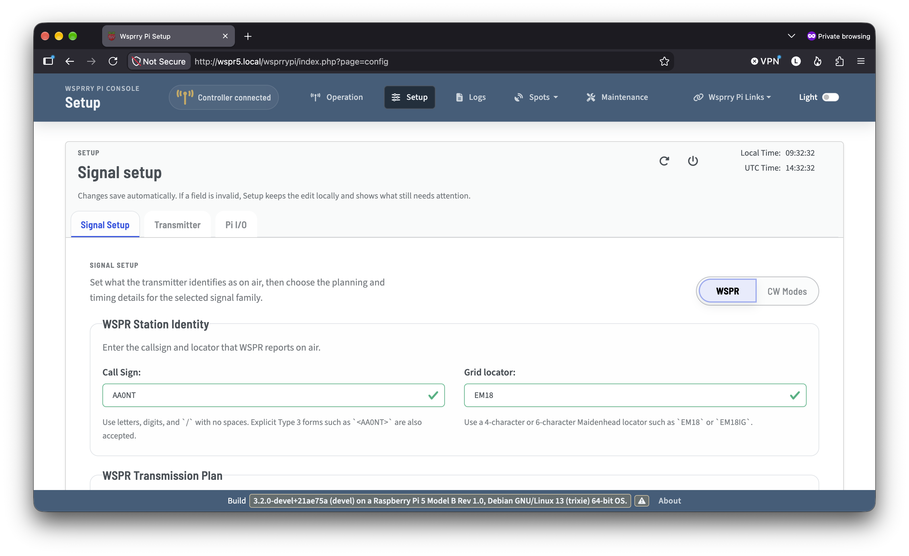
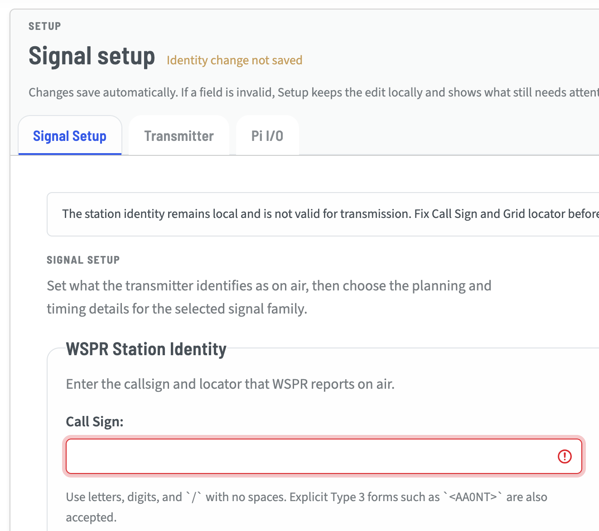

# Setup Card

This card is where your normal day-to-day configuration changes happen. Several settings are intentionally not exposed in the web UI because they are reserved for development and experimental use.

Ordinary Pi host settings autosave after validation. Read the status beside the Setup title before leaving the page. A saved value may still await runtime application while committed work owns the transmitter.

Fleet assignments and listener settings use explicit saves. Selected-member settings also use explicit controls: **Load member resources**, **Validate candidate pins**, **Save member station**, and **Save member hardware**. Editing those drafts never triggers host autosave. See [member resources](Transmitter/index.md#shared-pico-member-resources) before saving settings on a Pico. For independent station drafts in Fleet, see [Save station progress from Fleet](Transmitter/index.md#save-station-progress-from-fleet). The Pico's own browser save/apply workflow is documented in [Configure your station in the Pico manual](https://wsprrypico.readthedocs.io/en/devel/configure.html#understand-what-was-saved).

If a change cannot be saved, a brief status appears beside the Setup title. Details about what needs attention appear below the tabs:

Or, it will indicate that the settings have been successfully saved:

This contextual information is included on all sub-tabs and views within the Setup card.

The Setup card is divided into four sub-pages:

- [Configure WSPR and CW](Signal_Setup/index.md) for callsign, mode, and message-related settings.
- [Configure Transmitter](Transmitter/index.md) for hardware output-path selection and related transmission settings.
- [Configure Raspberry Pi I/O](Pi_IO/index.md) for Raspberry Pi pin assignments and indicator behavior.
- [Manage Fleet outputs](Transmitter/index.md#add-a-pico-and-manage-outputs) to add a Pico, select a remote output, update Pico firmware over USB, or assign independent schedules to saved Pi and Pico devices.

## Pi and Pico Fleet setup

Open **Setup → Fleet** to manage saved Pi and Pico devices and independent output schedules. No developer-console setting is required. The [device catalog workflow](Transmitter/index.md#add-a-pico-and-manage-outputs) explains how to identify and save a profile. Browsing Fleet does not start transmission. Pi servers use **Plain LAN**; this implementation does not provide inbound TLS on the Pi.

### Assign an output schedule

Fleet uses an absolute RF center for WSPR, a carrier for finite tone and QRSS, space for FSKCW, and dot for DFCW. With standard 20m operation, enter `14097100` for the WSPR RF center, not the `14095600` USB dial. Fleet adds no dial conversion or random placement. Mode changes update labels and help while retaining draft and saved frequency values. FSKCW mark and DFCW dash add the positive shift.

Fleet assignments and listener settings use explicit save buttons, unlike ordinary Setup autosave. Review the feedback beside the action before leaving.

1. Save and verify a profile for each target Pi or Pico. For a Pi, use its WTP port (default `31417`) and status HTTP port (default `31415`).
2. In **Output schedules**, choose **Assign a schedule**, select a **Saved output**, and enter its mode, RF reference in Hz, job parameters, repeat period, and UTC phase. For a Pi, confirm **Use Plain LAN for this assignment**.
3. Choose **Save assignment**. It starts paused unless **Start this output's schedule after saving** is selected. Use **Resume** when ready to run it.

A central Pi supports zero through eight remote output schedules alongside its own local schedule. **Use this device** selects the separate single-endpoint `[WTP]` backend; it does not create an independent output assignment. Saving or removing a catalog profile also does not create or remove an assignment.

Each target must advertise support for the assigned job. Native GPIO, RP1 and Si5351 Pi servers report their WSPR, TONE, QRSS, FSKCW and DFCW capabilities. The selected backend's processor, route and frequency policies still apply. RP1 retains its exact-operation host confirmation; Fleet does not create it. Pi and Pico jobs are checked against the selected target's reported capabilities. For a Pi profile, set the start-uncertainty limit to accommodate the reported clock uncertainty, no higher than `500000000` ns (500 ms); the existing 1 ms default can reject ordinary NTP timing. Values are never silently increased.

Remote scheduling requires the controller's explicit [unqualified-frequency permission](../../Command_Line_Operations/transmitter_backends.md#experimental-frequency-policy). A saved profile or discovered device does not grant that permission.

**Pause and stop**, **Edit schedule**, **Reconcile**, and **Remove assignment** affect only the selected output. Editing requires a paused, reconciled output. Failed or uncertain work pauses that assignment; after an interrupted job, use **Reconcile**, inspect the result, then **Resume**. A consumed schedule slot is not automatically retried. Other remote outputs and the local schedule remain independent. A disconnected target has unknown output state; loss of contact does not prove it stopped.

### Configure the target Pi

Expand **This Pi's WTP listener** to configure inbound admission, port, and interface, then choose **Save listener settings**. The listener defaults to enabled on port `31417`. With local Enable off, it accepts ownership claims after startup confirms safe, idle output. Local Enable on reserves the output, including gaps between local jobs; inspection remains available but new claims are refused. Outbound Fleet schedules do not change either setting.

`auto` selects a single eligible physical LAN IPv4 interface. If several are eligible, select one explicitly, such as `eth0` or `wlan0`. Avahi advertises the listener through DNS-SD. If discovery is unavailable, a manual Plain LAN profile can still use the configured address and port. A discovery entry is only a connection hint; identify the device before saving it. Plain LAN is unencrypted and its observed device ID is not cryptographic authentication.

See [local takeover](../index.md#local-control-and-remote-ownership) before reclaiming an output from a remote controller, and the [listener INI reference](../../Advanced_Operations/ini_configuration/runtime.md#wtp-server) for interface and recovery details.