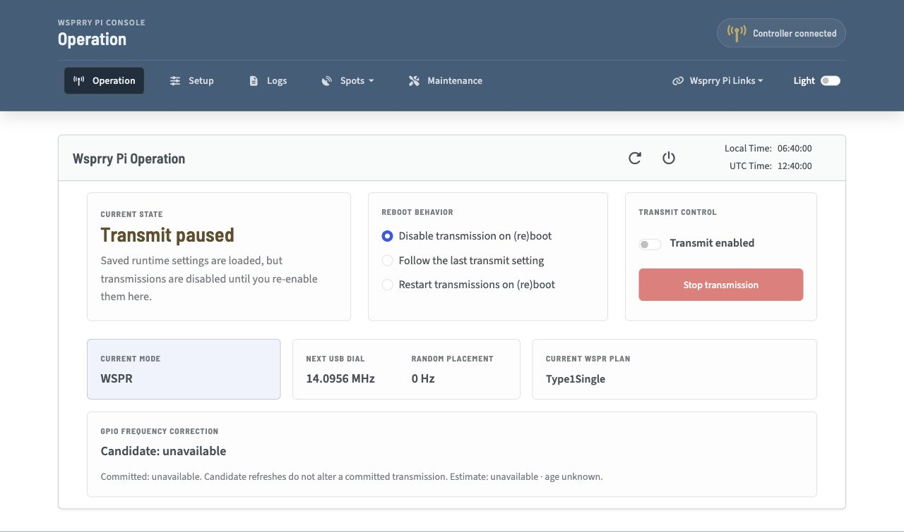
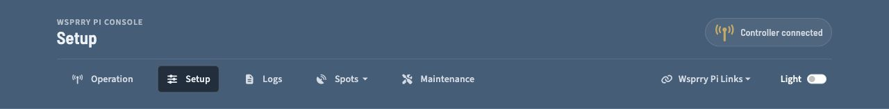
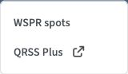
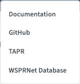
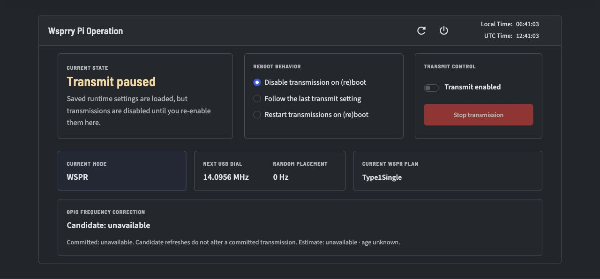
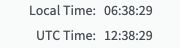

# User Interface

The web interface is the primary day-to-day control surface for WsprryPi. It provides configuration, status, logs, and recent spots in one responsive layout.

```{toctree}
:maxdepth: 1
:hidden:

Setup Overview <Setup/index>
Configure Transmitter <Setup/Transmitter/index>
Configure WSPR and CW <Setup/Signal_Setup/index>
Configure Raspberry Pi I/O <Setup/Pi_IO/index>
Operate Transmissions <Operations/index>
View Reception Reports <Spots/index>
View Logs <Logs/index>
Maintenance <Maintenance/index>
```



For a new station, follow [Your first WSPR transmission](../first_transmission.md).
For everyday operation:

1. Confirm the header indicators show a connection to the backend.
2. Review the transmitter, station, and schedule settings under **Setup**.
3. Start, monitor, and stop transmissions on **Operation**.
4. Check **Spots** for reception reports and **Logs** for diagnostic records.
5. Use **Maintenance** for recovery, test tones, updates, and support bundles.

## Browser requirements

Use a current Chrome, Edge, Firefox, or Safari browser with JavaScript enabled.
The interface is validated in Chromium; compatibility with every browser
or embedded web view has not been verified. Internet Explorer and EdgeHTML
are not supported.

An open page continues using its loaded interface until you refresh it. Before
choosing **Refresh** in the **UI refresh required** dialog or reloading the page,
check the save status and resolve any unsaved changes. Wait for valid changes to
show **Saved**, and correct errors or copy drafts you want to keep. Choose
**Cancel** if you are not ready to refresh. A reload may discard transient
drafts; it does not reset saved settings.

## Navbar

The navbar provides page links, controller connection status, and theme controls at the top of the page.

### Transmission Indicator


The controller-status badge shows the application connection and transmission state:

- **Red:** Indicates the web page is disconnected from the application. The page has just opened, and the WebSocket connection has not yet been negotiated. If it remains red, the daemon may not be running.
- **Orange:** Indicates the web page is negotiating the connection to the application.
- **Yellow/Gold:** Indicates the web page is connected to the application, but no transmission is in progress.
- **Green:** Indicates a transmission is in progress.

### Main Application Links



- **Operation:** The landing page and main view for active operations.
- **Setup:** Configure the transmission parameters and hardware interface.
- **Logs:** View the WsprryPi logs via a live interface to the Pi's `journald` daemon.
- **Spots:** Open reception-report resources for WSPR or QRSS.
- **Maintenance:** Configuration recovery, test-tone controls, update checks, and support-bundle creation.

#### Spots Menu



The **Spots** menu provides two reception-report destinations:

- **WSPR spots:** Opens the WsprryPi Spots page in the current browser tab. This page shows recent WSPR reception reports for your callsign.
- **QRSS Plus:** Opens the external [QRSS Plus](https://swharden.com/qrss/plus/) website in a new browser tab.

#### WsprryPi Links Dropdown



Four links are available here:

- **Documentation:** This documentation, hosted at Read the Docs.
- **GitHub:** The main GitHub organization, containing all of the repositories supporting this project.
- **TAPR:** TAPR is a non-profit 501(c)(3) organization of amateur radio (“ham”) operators who are interested in advancing the state of the radio art.  TAPR offers pre-built Pi HATs for WsprryPi in their store, among other items.
- **WSPRNet Database:** The WSPRnet database interface, where you may perform lookups on WSPR reports.

### Web Page Mode


WsprryPi supports a light and dark presentation mode in the web interface.



## Card Header

Each page contains a card with a shared header area. The header is the shaded region at the top of the main content card.

### Card Info

Contextual information about the current page appears on the left side of the card header.

#### Server Control

On the top right side before the clock are server control icons:


The icon on the left reboots the Raspberry Pi. When selected, the transmission LED, if configured, flashes twice and the system reboots.

The icon on the right powers off the Raspberry Pi. When selected, the transmission LED, if configured, flashes three times and the system shuts down immediately. In many setups, you need to remove and reapply power before the Pi can start again.

#### Clock

On the far right side of the card header is a clock displaying both local and UTC time:



## Application Pages / Card Bodies

The card body contains the page-specific controls and data. You may need to scroll to see all options. The layout is responsive and is intended to remain usable on both phones and desktop browsers.

Changes are saved as you make them.  The card header shows the save status.

The save status also identifies errors and directs you to the fields that need attention.

Information related to each page follows.

## Local control and remote ownership

From **Setup → Fleet**, this Pi can run its own schedule while
controlling other Pi or Pico outputs. Local **Enable**, this Pi's inbound WTP
listener, and each remote output's schedule are independent controls.

To reclaim a remotely owned Pi, open **that Pi's** web interface and select
**Enable**. Confirm removal of remote ownership and future schedule assignments.
For an armed or running remote job, choose:

- **End now** to stop the job immediately.
- **Let it finish** to allow the current job to finish before local output starts.
- **Cancel** to keep the existing ownership and saved Enable setting.

Both accepted choices prevent replacement remote jobs immediately. The central
controller cannot approve, delay, or veto this local action. Saved assignments
on the controller are removed when it next observes the takeover, including
when it was offline during the takeover.

With **Let it finish**, Enable is saved immediately, but effective local output
stays inhibited until the current job ends, and output-off is confirmed. If
output state remains unknown, local transmission and new remote claims stay
inhibited. Review the status beside the control and use **Reconcile local
output** to request a local stop/reset; successful recovery requires confirmed
inactive output.

A direct HTTP configuration write explicitly setting `Operation.Transmit=true`,
or an external enabled INI transaction, is noninteractive and immediately
cancels remote work. It does not offer the browser's finish-current choice.
See [Fleet and listener setup](Setup/index.md#pi-and-pico-fleet-setup).
